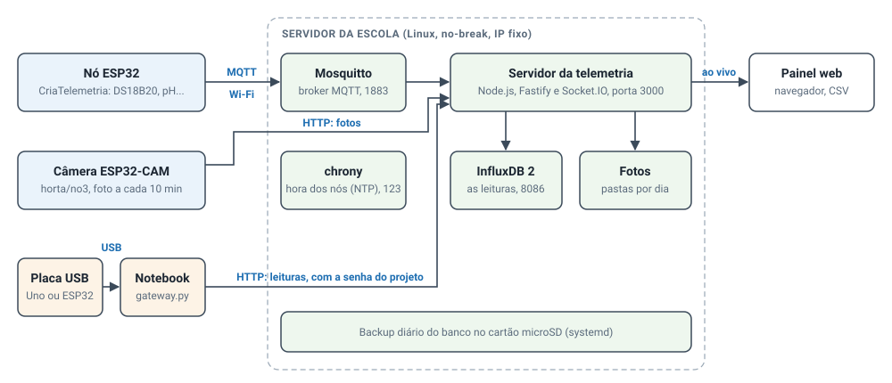
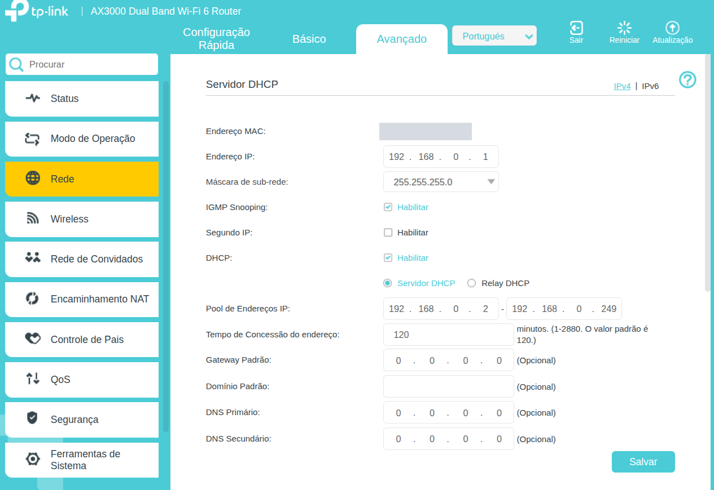
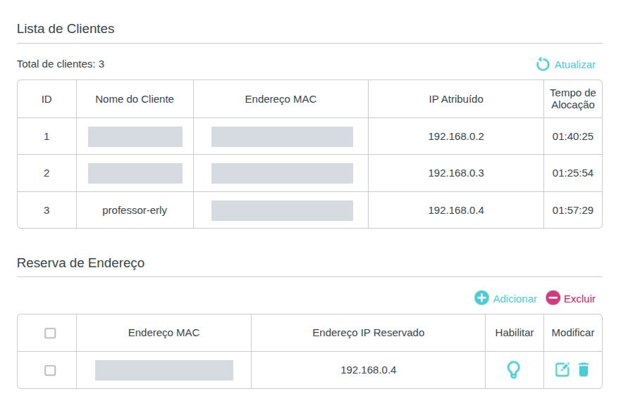
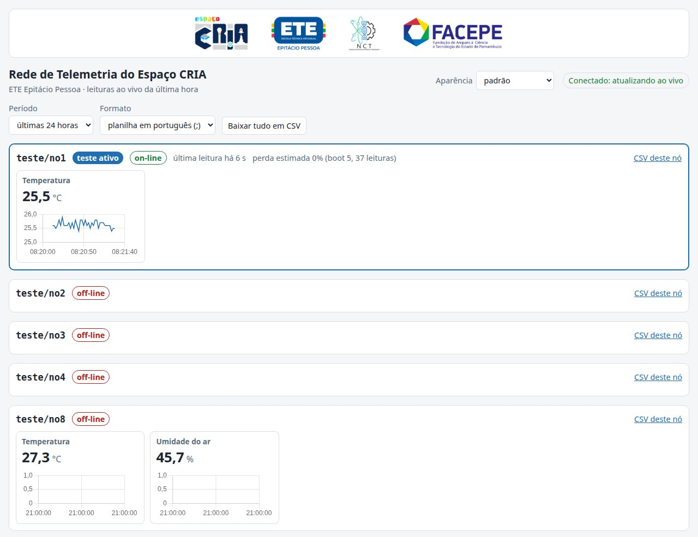
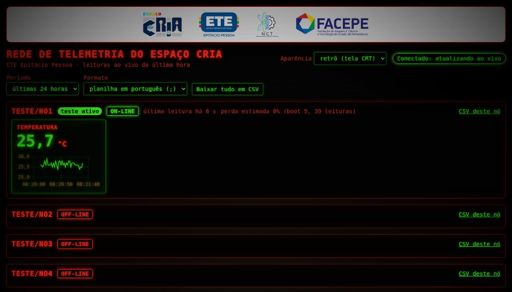
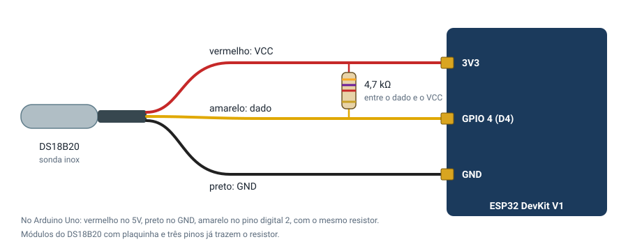
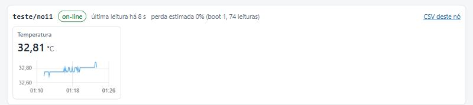

<p align="center" class="logos">
  
  &nbsp;&nbsp;
  
  &nbsp;&nbsp;
  
  &nbsp;&nbsp;
  
  &nbsp;&nbsp;
  
</p>

Este guia reúne, num documento só, tudo o que é preciso para reproduzir do zero a **Rede de Telemetria do Espaço CRIA**: o que é cada tecnologia usada, por que ela foi escolhida, como funciona, como instalar no Windows e no Linux, como iniciar o servidor e o painel e como acrescentar um nó de medição. Quem nunca viu o projeto consegue, só com ele, chegar a um sensor publicando no painel. O caminho da USB foi testado de ponta a ponta; o do Wi-Fi está descrito a partir do código e ainda aguarda o registro do teste com a rede da escola (seção 25.3).

O guia tem cinco partes:

- **Parte I, as tecnologias:** cada peça da plataforma, o que faz, por que está ali e como funciona.
- **Parte II, instalar:** as dependências de cada computador, no Windows e no Linux, e a instalação passo a passo.
- **Parte III, iniciar o servidor e o painel:** subir, conferir, usar o painel, testar sem placa e manter ligado.
- **Parte IV, adicionar um nó de medição:** pela USB com o gateway, pelo Wi-Fi com a biblioteca-padrão, e como trocar o sensor.
- **Parte V, usar e manter:** os dados, os problemas comuns e a referência rápida dos comandos.

Quem só quer instalar pode pular a Parte I e voltar a ela quando quiser entender o que instalou. Todos os exemplos de nó usam o sensor de temperatura **DS18B20**, o mais barato e o mais fácil de ligar de todos os sensores do projeto.

Os terminais e as telas das Partes IV e V foram capturados em 19/10/2026, com uma ESP32 DevKit ligada na porta COM5 de um notebook com Windows 11 e com o servidor de teste rodando num Ubuntu 26.04, dentro do WSL do mesmo notebook. As telas do painel da Parte III são de 24/11/2026, com o nó simulado, num servidor Linux.

Os detalhes de cada peça estão nos READMEs do repositório, citados ao longo do texto.

## Como a plataforma funciona



Uma leitura faz este caminho:

1. **O nó mede.** Um ESP32 com um sensor lê o valor e, com a biblioteca-padrão **CriaTelemetria**, publica uma mensagem no broker MQTT pelo Wi-Fi. Cada mensagem leva o valor, a unidade, um número de sequência (`seq`), o número da vez que o nó ligou (`boot`) e a hora da medida (`t`).
2. **O broker repassa.** O **Mosquitto**, no servidor da escola, recebe a mensagem e a entrega a quem assinou o tópico. Cada projeto tem um usuário e uma senha, e só publica dentro do próprio projeto.
3. **O servidor guarda e mostra.** O servidor da telemetria, em **Node.js**, assina todos os tópicos, confere cada mensagem contra o catálogo, grava no **InfluxDB** e repassa ao painel na hora, pelo Socket.IO.
4. **O painel exibe.** Qualquer navegador da rede abre o painel, vê os nós, os últimos valores, os gráficos da última hora e baixa os dados em CSV (um arquivo de texto com colunas, que as planilhas abrem).

As placas sem rede (Arduino Uno, ou uma ESP32 sem Wi-Fi configurado) usam um segundo caminho: escrevem as leituras pela **USB**, e um programa no notebook, o **gateway**, as envia ao servidor por HTTP com a senha do projeto.

O endereço de cada medida é um tópico com quatro partes, `cria/{projeto}/{no}/{grandeza}`, por exemplo `cria/teste/no11/temperatura`. As regras dos nomes, as unidades e os projetos registrados estão no [catálogo de tópicos](../mqtt/catalogo-topicos.md). O projeto `teste` é livre para as oficinas e para os testes deste guia.

Toda a plataforma roda na **rede local da escola, sem internet e sem serviço pago**. Essa escolha explica várias das tecnologias da Parte I: o servidor fornece a hora aos nós, o painel traz as próprias bibliotecas e nada depende de uma conta em nuvem.

# Parte I: as tecnologias

## 1. Visão geral

| Camada | Tecnologia | Para que serve | Onde fica no repositório |
| --- | --- | --- | --- |
| Nó de medição | ESP32, C++ com o núcleo Arduino | Ler o sensor e publicar pelo Wi-Fi | `firmware/` |
| Biblioteca do nó | CriaTelemetria, sobre a PubSubClient | Wi-Fi, broker, hora, `seq`, fila e calibração | `firmware/biblioteca-cria/` |
| Transporte | MQTT, com o broker Eclipse Mosquitto | Levar as mensagens dos nós ao servidor | `mqtt/` |
| Formato | JSON e o catálogo de tópicos | Todo nó fala a mesma língua | `mqtt/catalogo-topicos.md` |
| Hora | NTP, com o chrony | Um relógio só para a rede inteira | `servidor/base/` |
| Banco | InfluxDB 2 | Guardar cada leitura com a hora | `servidor/src/banco.js` |
| Servidor | Node.js com Fastify, MQTT.js e Socket.IO | Conferir, gravar e repassar as leituras | `servidor/src/` |
| Painel | HTML, CSS e JavaScript, com Chart.js | Mostrar ao vivo e exportar em CSV | `servidor/painel/` |
| Caminho USB | Python com pyserial, e HTTP | Placas sem rede | `gateway/`, `firmware/arduino-usb/` |
| Calibração | Python com pyserial | Corrigir cada sensor contra uma referência | `calibracao/` |
| Apoio | Git e GitHub, apt, systemd, WSL, pandoc | Versionar, instalar, manter ligado, documentar | todo o repositório |

As decisões técnicas mais importantes têm um arquivo cada na pasta `decisoes/`, com a data, o motivo e o que se perde com a escolha.

## 2. Os nós: ESP32, Arduino e as bibliotecas

### 2.1 ESP32

**O que é.** Um microcontrolador da Espressif com Wi-Fi e Bluetooth embutidos, dois núcleos de processamento e memória flash para o programa e para arquivos. A placa de referência do projeto é a **ESP32 DevKit V1 de 30 pinos**, que traz o chip, o regulador de tensão e um conversor USB-serial (CP210x ou CH340) para gravar o programa e conversar com o computador.

**Por que.** Custa pouco, tem Wi-Fi sem módulo extra, tem memória para guardar leituras quando a rede cai e é programado com o mesmo ambiente do Arduino, que os estudantes já conhecem.

**Como funciona, no que importa aqui:**

- trabalha em **3,3 V**. Sensores alimentados em 5 V, como os MQ, precisam de divisor de tensão na saída;
- os pinos **GPIO 21 e 22** ficam reservados ao barramento I2C (ADS1115, BH1750, DS3231);
- o conversor analógico **ADC2 não funciona com o Wi-Fi ligado**; as leituras analógicas usam o ADC1 ou o ADS1115 externo, de 16 bits;
- a **memória flash** guarda três coisas além do programa: o contador `boot` e as retas de calibração (pela biblioteca *Preferences*) e a fila de leituras que esperam envio (num sistema de arquivos, o *LittleFS*). Nenhuma delas se apaga ao desligar a placa.

Duas variações aparecem no projeto: a **ESP32-CAM**, que fotografa a horta para o time-lapse, e o **Arduino Uno R3**, placa legada sem rede, que usa o caminho da USB (seção 9).

### 2.2 Arduino: a linguagem, o núcleo e a IDE

**O que é.** "Arduino" são três coisas: uma forma de escrever programas em **C++** com duas funções (`setup()`, que roda uma vez, e `loop()`, que roda para sempre), um conjunto de bibliotecas prontas e um programa de computador, a **Arduino IDE**, que compila e grava o programa na placa. O programa de uma placa chama-se *sketch* e fica num arquivo `.ino`.

**O núcleo esp32.** A Arduino IDE não conhece o ESP32 de fábrica. O **núcleo esp32**, da Espressif, é o pacote que ensina a IDE a compilar para ele e traz as bibliotecas do chip: `WiFi`, `Preferences`, `LittleFS`, `HTTPClient` e a da câmera. O projeto usa a **série 3** do núcleo (foi testado com a 3.3.12).

**Por que.** É o ambiente das oficinas do plano de formação, funciona igual no Windows e no Linux e tem biblioteca pronta para quase todo sensor. Quem prefere a linha de comando usa o **arduino-cli**, que compila e grava sem abrir a IDE.

### 2.3 As bibliotecas dos sketches

| Biblioteca | Autor | Para que serve | Quem usa |
| --- | --- | --- | --- |
| **CriaTelemetria** | equipe do projeto | Tudo o que não é ler o sensor (seção 2.4) | Todos os nós Wi-Fi |
| **PubSubClient** | Nick O'Leary | Cliente MQTT: conecta no broker e publica | A CriaTelemetria, por baixo |
| **OneWire** | Jim Studt e outros | O protocolo de um fio só do DS18B20 | `arduino-usb`, `NoDS18B20`, `horta-no1` |
| **DallasTemperature** | Miles Burton | Lê a temperatura do DS18B20 sobre a OneWire | Os mesmos |
| **DHT sensor library** | Adafruit | Temperatura e umidade do DHT22 | `PrimeiroNo`, `no-ar`, `horta-no2` |
| **Adafruit ADS1X15** | Adafruit | Conversor analógico ADS1115, de 16 bits | `horta-no1` (pH e condutividade) |
| **BH1750** | Christopher Laws | Sensor de iluminância | `horta-no2` |

As bibliotecas `WiFi`, `Wire` (I2C), `Preferences`, `LittleFS`, `HTTPClient` e a da câmera já vêm com o núcleo esp32 e não são instaladas à parte. Para os testes deste guia bastam três: PubSubClient, OneWire e DallasTemperature.

### 2.4 A biblioteca-padrão CriaTelemetria

**O que é.** A biblioteca escrita pelo projeto, em `firmware/biblioteca-cria/`. É o produto de reuso da plataforma: com ela, um nó novo só precisa ler o próprio sensor e chamar `publicar()`.

**Por que.** Sem ela, cada estudante escreveria do seu jeito a conexão, a reconexão, o formato da mensagem e a fila. Bastaria um nó formatar a mensagem diferente para o servidor deixar de saber o que está gravando.

**Como funciona.** A biblioteca:

- conecta no Wi-Fi e reconecta quando a rede cai;
- conecta no broker com o usuário do projeto e avisa quando está on-line e off-line;
- acerta o relógio pelo servidor de hora da rede, só começa a medir depois disso e confere a hora a cada 15 minutos;
- numera as leituras (`seq`) e conta as vezes que o nó ligou (`boot`);
- guarda na memória flash as leituras feitas sem conexão e as reenvia, marcadas com `"fila":1`, quando a conexão volta, mesmo que o nó tenha reiniciado nesse meio-tempo;
- com um relógio DS3231, volta a medir depois de um corte de energia mesmo sem rede;
- guarda a calibração de cada sensor na memória do nó (classe `CriaCalibracao`).

A referência completa, função por função, está em [`firmware/biblioteca-cria/README.md`](../firmware/biblioteca-cria/README.md).

### 2.5 O sensor dos exemplos: DS18B20

**O que é.** Um termômetro digital, de −55 a 125 °C, com erro de até 0,5 °C. A versão usada vem dentro de uma ponta de aço à prova d'água, com três fios.

**Por que.** É barato, pode ser mergulhado e entrega a temperatura já em número: dispensa o conversor analógico e as contas de tensão.

**Como funciona.** Conversa com a placa por um fio só de dados, no protocolo **1-Wire**. Esse fio precisa de um resistor de 4,7 kΩ até a alimentação (*pull-up*), que mantém o sinal em nível alto quando ninguém está falando. Sem o resistor, ou com o sensor solto, a leitura dá −127 °C.

## 3. O transporte: Wi-Fi, MQTT e Mosquitto

### 3.1 MQTT

**O que é.** Um protocolo de mensagens feito para sensores: leve, com conexão permanente e mensagens pequenas. Funciona no modelo **publicar e assinar**: quem mede *publica* num **tópico** (um endereço em texto, como `cria/horta/no1/ph`), e quem quer receber *assina* o tópico. No meio fica o **broker**, o programa que recebe todas as publicações e as entrega aos assinantes. O nó não precisa saber quem vai ler, nem o servidor precisa conhecer cada nó.

**Por que.** Um nó novo entra na rede sem ninguém mexer no servidor: basta publicar num tópico que siga o catálogo. O servidor assina `cria/#` (o `#` quer dizer "tudo o que vier abaixo") e recebe qualquer nó, de qualquer projeto. Além disso, o MQTT avisa sozinho quando um nó cai.

**Como funciona, no que o projeto usa:**

- **Tópico:** `cria/{projeto}/{no}/{grandeza}`. Cada leitura é uma mensagem num tópico desses.
- **QoS (nível de entrega):** as leituras dos nós saem com **QoS 0**, sem confirmação, que é o único nível que a PubSubClient usa para publicar. A confirmação é feita pelo próprio dado: como cada leitura leva `seq` e `boot`, o servidor sabe exatamente quais se perderam (`decisoes/2026-10-18-qos0-com-seq-e-boot.md`).
- **Retain (mensagem guardada):** o broker guarda a última mensagem de um tópico e a entrega a quem assinar depois. É usado só no tópico `status` de cada nó, para um painel aberto mais tarde saber o estado atual.
- **LWT (última vontade):** ao conectar, o nó deixa combinada com o broker a mensagem `offline`. Se o nó sumir sem avisar, o próprio broker a publica. É assim que o painel mostra um nó off-line.
- **Keepalive (sinal de vida):** o prazo combinado entre o nó e o broker, de 5 s na CriaTelemetria. Sem notícia do nó por 1,5 vez esse prazo, o broker o dá por desconectado: o `offline` aparece em até cerca de 8 s.
- **Sessão persistente:** o servidor se conecta com um identificador fixo. Enquanto ele estiver fora do ar, o broker guarda as leituras que chegarem e as entrega quando ele voltar.

### 3.2 Mosquitto

**O que é.** O **Eclipse Mosquitto** é o broker MQTT da plataforma: um programa pequeno, de código aberto, que roda como serviço no servidor e atende na **porta 1883**. O pacote `mosquitto-clients` traz dois programas de teste, o `mosquitto_pub` (publica) e o `mosquitto_sub` (assina), usados para conferir a rede sem placa nenhuma.

**Por que.** É o broker mais usado em projetos de ensino, está no `apt` do Ubuntu e do Debian, gasta pouca memória e é o das oficinas do projeto.

**Como está configurado** (`mqtt/mosquitto.exemplo.conf` e `mqtt/acl`):

- **ninguém entra sem usuário e senha** (`allow_anonymous false`); as senhas ficam cifradas em `/etc/mosquitto/senhas`;
- **cada projeto é um usuário**, com o mesmo nome do projeto: `ar`, `horta`, `teste`;
- **a ACL (lista de controle de acesso)** tem uma regra só, `pattern readwrite cria/%u/#`, em que `%u` é o nome do usuário. Um nó da `horta` não consegue escrever em `cria/ar/...`;
- o usuário **`servidor`** lê a rede inteira (`cria/#`) e não publica leituras; por isso `servidor` não pode ser nome de projeto;
- o broker **guarda até 20000 mensagens** para o servidor enquanto ele estiver fora, cerca de 4 h da rede inteira.

### 3.3 Wi-Fi

Os nós usam uma **rede Wi-Fi dedicada à telemetria**, de um ponto de acesso próprio, sem internet. O servidor recebe um **IP fixo** nesse ponto de acesso (reserva de DHCP pelo endereço MAC): é esse IP que vai no programa de cada nó, no gateway e no navegador. O ESP32 só usa redes de 2,4 GHz.

## 4. O formato: JSON e o catálogo de tópicos

**JSON** é um formato de texto para dados, com pares de nome e valor entre chaves. Cada leitura é uma linha JSON:

```json
{"valor": 6.12, "unidade": "pH", "seq": 1834, "boot": 7, "t": 1792345678123}
```

| Campo | Significado | Para que existe |
| --- | --- | --- |
| `valor` | O valor medido, já calibrado | É a medida |
| `unidade` | A unidade que o catálogo fixa para a grandeza | Evita gravar a mesma grandeza em duas unidades |
| `seq` | O número da leitura no nó; cresce de 1 em 1 e volta a 1 quando o nó liga | Medir a perda de pacotes |
| `boot` | Quantas vezes o nó já ligou | Separar as contagens do `seq` |
| `t` | O instante da leitura, em milissegundos desde 01/01/1970 (UTC) | Medir a latência e gravar com a hora certa |
| `fila` | Opcional; `1` quando a leitura esperou na fila | Deixar essas leituras fora da medida de latência |

**Por que JSON.** É texto legível num terminal, toda linguagem do projeto (C++, JavaScript, Python) lê e escreve, e um campo novo não quebra quem já funciona.

**O catálogo de tópicos** ([`mqtt/catalogo-topicos.md`](../mqtt/catalogo-topicos.md)) é o contrato da rede: as regras dos nomes, a unidade de cada grandeza e os projetos registrados. O servidor confere o formato de cada mensagem (os nomes, a unidade em caracteres simples, o `seq`, o `boot` e o `t`) e descarta as que fogem das regras. Quem barra um projeto não registrado é o broker, que não tem usuário para ele. As regras principais:

- projeto e grandeza em minúsculas, sem acento nem espaço: `temperatura`, `condutividade`;
- o nó é a palavra `no` seguida do número: `no1`, `no2`, ..., sem zero à esquerda;
- a grandeza tem o nome da grandeza física, não o do sensor: `temperatura`, e não `ds18b20`;
- as unidades usam só caracteres simples: `C` em vez de `°C`, `uS/cm` em vez de `µS/cm`;
- leitura com falha (sensor desconectado, `NaN`) não é publicada.

## 5. A hora: NTP e chrony

**O que é.** O **NTP** é o protocolo pelo qual um computador pergunta a hora a outro. O **chrony** é o programa que, no servidor, responde a essas perguntas, na **porta 123 (UDP)**.

**Por que.** Cada leitura leva a hora em que foi medida (`t`), e a latência é a diferença entre essa hora e a do servidor. Isso só funciona se todos usarem **o mesmo relógio**. Como a rede da telemetria não tem internet, os nós não alcançam os servidores de hora públicos: o servidor da escola faz esse papel.

**Como funciona.** O arquivo `servidor/base/chrony-cria.conf` diz ao chrony para fornecer a hora do relógio do próprio computador mesmo sem fonte externa (`local stratum 10`) e para atender as faixas de endereços das redes privadas. O nó pede a hora ao ligar e **só começa a medir depois de recebê-la**. O nó `horta/no1` tem ainda um relógio com bateria, o **DS3231**, para voltar a medir depois de um corte de energia mesmo sem rede.

## 6. O banco: InfluxDB 2

**O que é.** Um banco de dados de **séries temporais**: feito para guardar valores que chegam um atrás do outro, cada um com a sua hora, e para responder rápido a perguntas como "a temperatura da última hora". Atende na **porta 8086** e traz uma interface web própria para explorar os dados.

**Por que.** Uma leitura de sensor é exatamente um valor com hora. O InfluxDB 2 é de código aberto, continua mantido, é o banco das oficinas do projeto e instala pelo `apt` como um serviço comum do sistema, sem Docker (`decisoes/2026-10-18-influxdb-2-instalado-pelo-apt.md`).

**Como funciona, com os nomes do projeto:**

| Conceito do InfluxDB | No projeto |
| --- | --- |
| **Organização** | `cria` |
| **Bucket** (o "balde" dos dados) | `telemetria`, sem prazo de validade |
| **Medida** (*measurement*) | `leitura`; a latência do painel vai para `latencia_painel` |
| **Etiquetas** (*tags*, que identificam a série) | `projeto`, `no`, `grandeza`, `unidade` |
| **Campos** (*fields*, os valores) | `valor`, `seq`, `boot` e, quando houver, `fila` |
| **Hora do ponto** | o `t` da leitura: a hora em que o nó mediu, não a em que chegou |
| **Token** | a "senha" de acesso; o do servidor só lê e escreve no bucket `telemetria` |

O servidor grava em lotes (a cada 250 ms ou 100 pontos) e consulta com a linguagem **Flux**. Se o banco cair, as leituras continuam chegando ao painel e esperam na memória do servidor por até 2 horas.

## 7. O servidor: Node.js e as bibliotecas

### 7.1 Node.js e npm

**O que é.** O **Node.js** executa programas em JavaScript fora do navegador. O **npm**, que vem junto, baixa as bibliotecas de que o programa depende, listadas no arquivo `servidor/package.json`, para a pasta `servidor/node_modules`.

**Por que.** O servidor passa o tempo todo esperando mensagens (do broker, do banco, dos navegadores), e o Node.js é feito para isso. O painel também é em JavaScript: a equipe usa uma linguagem só no servidor e no navegador.

**Versão.** O projeto exige o **Node.js 22 ou mais novo**: o servidor usa recursos dessa geração, como a leitura do arquivo `.env` (`process.loadEnvFile`) e os testes automáticos embutidos (`node --test`), sem biblioteca extra.

### 7.2 As bibliotecas do servidor

| Biblioteca | O que é | O que faz aqui |
| --- | --- | --- |
| **Fastify** | Um servidor web para Node.js | Atende o painel e as rotas HTTP: `/saude`, `/api/nos`, `/api/historico`, `/api/exportar.csv`, `/api/leituras`, `/api/imagens` |
| **@fastify/static** | Complemento do Fastify | Entrega os arquivos do painel e o Chart.js |
| **mqtt** (MQTT.js) | Cliente MQTT para Node.js | Assina `cria/#` no broker; publica as leituras que chegam por HTTP |
| **Socket.IO** | Canal de mão dupla entre servidor e navegador | Empurra cada leitura ao painel no instante em que chega, sem o navegador precisar perguntar |
| **@influxdata/influxdb-client** | Cliente oficial do InfluxDB 2 | Grava as leituras e faz as consultas |
| **Chart.js** | Biblioteca de gráficos para o navegador | Desenha os gráficos do painel |

O `npm install` baixa todas da internet uma única vez. Depois disso, o servidor as entrega ele mesmo ao navegador: o painel funciona sem internet.

### 7.3 Como o servidor funciona

O programa principal é `servidor/src/servidor.js`. Para cada mensagem que chega do broker:

1. `assinante.js` recebe a mensagem do tópico `cria/...`;
2. `catalogo.js` confere o tópico e o JSON contra as regras do catálogo; o que não passa é contado como inválido e descartado;
3. `estado.js` atualiza o estado do nó na memória (on-line, último valor, perda estimada);
4. `banco.js` grava a leitura no InfluxDB, com a hora em que o nó mediu;
5. o Socket.IO repassa a leitura a todos os painéis abertos.

O servidor lê a configuração do arquivo **`.env`**, na raiz do repositório: endereço e senha do broker, endereço e token do banco, porta do painel. Esse arquivo guarda senhas, só o dono lê e nunca vai para o GitHub.

A rota **`/saude`** responde, em JSON, se o broker está conectado, se o banco responde e quantas leituras chegaram. É o primeiro lugar para olhar quando algo parece errado.

## 8. O painel: HTML, CSS, JavaScript e Chart.js

**O que é.** Uma página web servida pelo próprio servidor, em `servidor/painel/`: `index.html` (a estrutura), `painel.css` e `retro.css` (os dois perfis de aparência) e `painel.js` (o comportamento).

**Por que assim.** É escrito em HTML, CSS e JavaScript puros, **sem etapa de compilação**: quem abre o arquivo vê o código que roda, e um estudante consegue mudar uma cor ou um texto e ver o resultado ao recarregar a página. Abre em qualquer navegador da rede, inclusive no celular, sem instalar nada.

**Como funciona.** Ao abrir, o painel se conecta ao servidor pelo Socket.IO e recebe a lista dos nós. Para cada grandeza, pede a última hora de dados (`/api/historico`) e desenha o gráfico com o **Chart.js**. Daí em diante, cada leitura nova chega sozinha e entra no gráfico. O painel usa a hora do servidor, e não a do aparelho: um celular com o relógio errado mostra o mesmo que os outros.

## 9. O caminho da USB: Python, pyserial e HTTP

**O que é.** Para as placas sem rede, a leitura sai pela **porta serial** (o cabo USB), uma linha JSON por leitura. No computador ao lado, o **gateway** (`gateway/gateway.py`) lê essas linhas e as envia ao servidor por **HTTP**, na rota `POST /api/leituras`.

| Tecnologia | O que é | O que faz aqui |
| --- | --- | --- |
| **Python 3** | Linguagem de programação de uso geral | O gateway e a ferramenta de calibração |
| **pyserial** | Biblioteca Python para a porta serial | Ler o que a placa escreve; enviar comandos de calibração |
| **HTTP com autenticação Basic** | O protocolo da web, com usuário e senha no pedido | Levar as leituras ao servidor com a senha do projeto |

**Por que Python.** Já vem instalado no Linux, instala em um passo no Windows, e o gateway cabe num arquivo só, com uma única dependência (a pyserial). O envio por HTTP usa só o que já vem com o Python.

**Como funciona.** O gateway acrescenta a cada leitura a hora (`t`) e o `boot`, que a placa sem relógio não tem. O servidor **não guarda a senha dos projetos**: ele publica as leituras no broker com o usuário e a senha recebidos, e quem confere a senha é o próprio broker. Assim, a rota HTTP não vira uma porta lateral à ACL, e as leituras da USB seguem o mesmo caminho das que vêm do Wi-Fi.

## 10. As ferramentas de apoio

| Ferramenta | O que é | Para que serve aqui |
| --- | --- | --- |
| **Git** | Controle de versões | Guardar o histórico de todo o código e de todos os textos |
| **GitHub** | Site que hospeda repositórios Git | Guardar o repositório `telemetria-cria` e revisar as mudanças por *pull request* (o pedido para juntar uma mudança ao código principal; veja o [Tutorial 00](00-conta-github-e-git.md)) |
| **apt** | Instalador de programas do Ubuntu e do Debian | Instalar o Mosquitto, o chrony e o InfluxDB |
| **systemd** | Gerenciador de serviços do Linux | Manter o broker, a hora e o banco ligados e subi-los quando o computador liga (`systemctl`, `journalctl`) |
| **ufw** | Firewall simples do Ubuntu | Liberar as portas da telemetria |
| **Bash** | O interpretador de comandos do Linux | Os scripts de instalação e de backup |
| **WSL** | Subsistema do Windows para Linux | Rodar um servidor de teste num notebook com Windows |
| **nvm** | Gerenciador de versões do Node.js | Instalar o Node.js 22 sem depender da versão do `apt` |
| **curl** | Programa que faz pedidos HTTP pelo terminal | Baixar o instalador do nvm; conferir a rota `/saude` |
| **tmux** | Terminal que continua rodando depois de fechado | Deixar o servidor ligado enquanto não há serviço do sistema |
| **SSH** | Acesso ao terminal de outro computador pela rede | Cuidar do servidor a partir do notebook (opcional) |
| **winget** | Instalador de programas do Windows, pelo terminal | Instalar o Git, a Arduino IDE, o Python e o Node.js (opcional) |
| **pandoc** e um navegador | Conversor de documentos | Gerar este guia em HTML e em PDF a partir do Markdown |

**As portas da plataforma**, todas no servidor:

| Porta | Protocolo | Quem atende | Quem usa |
| --- | --- | --- | --- |
| 1883 | TCP | Mosquitto (MQTT) | Os nós e o servidor da telemetria |
| 123 | UDP | chrony (NTP) | Os nós, para acertar o relógio |
| 8086 | TCP | InfluxDB | O servidor da telemetria e a interface web do banco |
| 3000 | TCP | Servidor da telemetria (HTTP) | Os navegadores, o gateway e a câmera |

# Parte II: instalar

## 11. O que instalar em cada computador

A plataforma usa dois tipos de computador:

- **o servidor**, que fica ligado o tempo todo com o broker, a hora, o banco e o painel;
- **o computador de desenvolvimento**, de quem programa as placas, roda o gateway e calibra os sensores.

Num teste em casa, os dois podem ser o mesmo notebook.

### 11.1 O servidor

O servidor roda em **Linux**: o instalador usa o `apt` e o `systemd`, e por isso exige **Ubuntu 22.04 ou mais novo**, ou **Debian 12 ou mais novo**. Num computador com **Windows**, o servidor roda dentro do **WSL**, que é um Ubuntu de verdade dentro do Windows (seção 14). Não há instalação direta no Windows.

| Dependência | Versão | Como chega | Para que |
| --- | --- | --- | --- |
| Ubuntu ou Debian | 22.04+ ou 12+ | Já instalado, ou pelo WSL no Windows | O sistema do servidor |
| Git | qualquer | `sudo apt update && sudo apt install git` | Baixar o repositório |
| Mosquitto e `mosquitto-clients` | 2.0 | Pelo instalador do projeto | Broker MQTT e programas de teste |
| chrony | 4 | Pelo instalador | Servidor de hora |
| InfluxDB 2 e `influx` | 2.x | Pelo instalador, do repositório oficial da InfluxData | Banco de séries temporais |
| `curl`, `gnupg`, `python3` | qualquer | Pelo instalador | Usados pelo próprio instalador |
| **Node.js** | **22 ou mais novo** | À mão (seção 13.2) | O servidor da telemetria e o painel |
| Bibliotecas do `package.json` | as do `package-lock.json` | `npm install` | Fastify, Socket.IO, MQTT.js, cliente do InfluxDB, Chart.js |

Só o Node.js e o Git são instalados à mão. O instalador foi testado no Ubuntu 26.04, onde instalou o Mosquitto 2.0.22, o chrony 4.8 e o InfluxDB 2.9.1. O computador precisa de internet **durante a instalação**; depois, funciona sem ela.

### 11.2 O computador de desenvolvimento

| Dependência | Windows 10 ou 11 | Linux (Ubuntu ou Debian) | Para que |
| --- | --- | --- | --- |
| **Git** | [Git para Windows](https://git-scm.com/download/win), que traz o Git Bash | `sudo apt update && sudo apt install git` | Baixar o repositório |
| **Arduino IDE 2** | Instalador `.exe` de [arduino.cc/en/software](https://www.arduino.cc/en/software) | AppImage do mesmo site (um arquivo único, que roda sem instalar) | Compilar e gravar as placas |
| **Núcleo esp32** (versão 3.3.x) | Pelo Gerenciador de Placas da IDE | Igual | Compilar para o ESP32 |
| **Bibliotecas Arduino** | Pelo Gerenciador de Bibliotecas da IDE | Igual | PubSubClient, OneWire, DallasTemperature |
| **Driver USB da placa** | CP210x (Silicon Labs) ou CH340 (WCH), conforme o chip | Já vem no sistema | A placa aparecer como porta serial |
| **Acesso à porta serial** | Nada a fazer | Grupo `dialout`; remover o `brltty` se atrapalhar | Usar a porta sem ser administrador |
| **Python 3** (3.9 ou mais novo) | Pelo site [python.org](https://www.python.org/downloads/) (seção 15.2) | Já vem no sistema | Gateway e calibração |
| **pyserial** | `py -m pip install -r gateway/requirements.txt` | `sudo apt install python3-serial` | Ler a porta serial |
| **pandoc** e Chrome, Chromium ou Edge (opcional) | Instalador de [pandoc.org](https://pandoc.org/installing.html) | `sudo apt install pandoc` | Só para gerar este guia em HTML e PDF |
| **Node.js 22+** (opcional) | Instalador LTS (a versão de suporte longo, a recomendada) de [nodejs.org](https://nodejs.org/) | Como no servidor (seção 13.2); instale antes o curl, com `sudo apt install curl` | Só para rodar o nó simulado ou os testes do servidor neste computador |

No Windows, quem prefere instalar pelo terminal pode usar o `winget`, que vem com o Windows 10 e 11 atualizados. Num PowerShell:

```
winget install Git.Git
winget install ArduinoSA.IDE.stable
winget install Python.Python.3.13
winget install OpenJS.NodeJS.LTS
```

Feche e abra o terminal depois de instalar, para ele enxergar os programas novos.

### 11.3 O material para o primeiro nó

| Item | Observação |
| --- | --- |
| Placa **ESP32 DevKit V1** (30 pinos) | Qualquer ESP32 com chip USB CP210x ou CH340 serve |
| Cabo USB **de dados** | Cabo só de carga não serve: a placa acende, mas não aparece no computador |
| Sensor **DS18B20** à prova d'água | Três fios: vermelho, preto e amarelo |
| Resistor de **4,7 kΩ** | Entre o fio amarelo e o vermelho. Os módulos com plaquinha já trazem |
| Protoboard e jumpers | |

Para o nó pelo Wi-Fi falta ainda um **ponto de acesso Wi-Fi de 2,4 GHz** na mesma rede do servidor.

**Com o coordenador**, quando o servidor já existe: o endereço IP do servidor, a senha MQTT do projeto `teste` e o nome e a senha da rede Wi-Fi da telemetria.

## 12. Baixar o repositório

Todo o software fica no repositório [telemetria-cria](https://github.com/ErlyAquino/telemetria-cria). Ele precisa ser clonado no servidor e no computador de desenvolvimento. O passo a passo do Git, da conta no GitHub e do fluxo de trabalho está no [Tutorial 00](00-conta-github-e-git.md); em resumo:

```bash
git clone https://github.com/ErlyAquino/telemetria-cria.git
cd telemetria-cria
```

No Windows, use o **Git Bash** ou o PowerShell. Os comandos deste guia partem **da raiz do repositório** (a pasta `telemetria-cria`). Os do servidor da telemetria começam com `cd servidor`: se o terminal já estiver nessa pasta, pule essa linha.

## 13. O servidor (Linux)

### 13.1 O servidor base: broker, hora e banco

No servidor, na raiz do repositório, com o computador ligado à internet:

```bash
sudo bash servidor/base/instalar.sh
```

Num Debian instalado com senha de root, o `sudo` pode não existir: entre como root com `su -`, vá até a pasta do repositório e rode o mesmo comando sem o `sudo`. Os outros comandos deste guia usam o `sudo`: ainda como root, instale-o e dê a permissão ao seu usuário com `apt install sudo && usermod -aG sudo SEU_USUARIO`. Quando o script terminar, saia do root com `exit`, saia da sua conta e entre de novo: os passos seguintes são feitos com o seu usuário comum.

O script faz, em ordem:

1. instala os pacotes `mosquitto`, `mosquitto-clients`, `chrony`, `curl`, `gnupg` e `python3`;
2. configura o Mosquitto com senha e ACL, e **pede a senha de cada usuário MQTT**: `servidor`, `ar`, `horta` e `teste`;
3. configura o chrony para atender os nós da rede local, mesmo sem internet;
4. acrescenta o repositório oficial da InfluxData (conferindo a impressão digital da chave), instala o InfluxDB 2, **pede o usuário e a senha do administrador do banco** (pelo menos 8 caracteres), cria a organização `cria`, o bucket `telemetria` e um token que só lê e escreve nesse bucket;
5. libera as portas 1883, 123 e 8086 no firewall, se o `ufw` estiver ativo, e faz um autoteste.

Anote as senhas num lugar seguro, fora do repositório. Elas aceitam letras sem acento, algarismos e os sinais `. _ @ % + = : , ! ? -`. Outros sinais, como `#`, aspas e barra invertida, são recusados porque mudariam a senha no caminho até os arquivos de configuração.

No fim, o autoteste escreve `OK` ou `FALHA` em três conferências:

- o usuário `servidor` recebe o que o projeto `teste` publica;
- o usuário `teste` não consegue publicar no projeto `horta` (a ACL funciona);
- o broker recusa quem chega sem usuário e senha.

O script também cria o arquivo **`.env`** na raiz do repositório, com a senha do `servidor`, a do `teste` e o token do banco. O script pode ser rodado de novo: o que já estiver feito é mantido.

Depois de instalar:

- **Reserve um IP fixo para o servidor** no ponto de acesso da telemetria (seção 13.4). O script mostra os endereços do computador no final.
- **Guarde uma cópia de `/root/.influxdbv2/configs`** fora do servidor: é o único lugar com o token de administrador do banco. Só o root lê esse arquivo: copie-o com `sudo cp /root/.influxdbv2/configs ~/influx-configs-copia`, leve a cópia para um pendrive guardado com o coordenador e apague-a do servidor.
- **Ligue o computador num no-break**, se ele for o servidor de verdade.
- **Libere a porta do painel**, se o firewall `ufw` estiver ativo (`sudo ufw status` responde `Status: active` ou `Estado: ativo`). O instalador não a abre:

  ```bash
  sudo ufw allow 3000/tcp comment 'Painel da telemetria'
  ```

Os comandos de manutenção estão em [`servidor/base/README.md`](../servidor/base/README.md).

### 13.2 O Node.js

O servidor da telemetria precisa do **Node.js 22 ou mais novo**. Confira primeiro o que o sistema oferece:

```bash
node --version
```

Se o comando não existir ou mostrar uma versão abaixo de 22, instale o Node.js 22, a versão com que o projeto foi testado (uma versão LTS mais nova também atende à exigência). A do `apt` costuma ser antiga; o caminho mais simples é o **nvm**, o gerenciador de versões indicado em [nodejs.org](https://nodejs.org/en/download):

```bash
curl -o- https://raw.githubusercontent.com/nvm-sh/nvm/v0.40.3/install.sh | bash
```

Feche o terminal e abra outro (ou rode `source ~/.bashrc`) e:

```bash
nvm install 22
node --version     # deve mostrar v22 ou mais novo
npm --version
```

O nvm instala o Node.js só para o seu usuário, sem `sudo`. Em [nodejs.org](https://nodejs.org/en/download) há outras formas de instalar, se a escola preferir.

### 13.3 As bibliotecas do servidor

A partir da raiz do repositório, uma única vez (e de novo sempre que o `package.json` mudar):

```bash
cd servidor
npm install
```

O `npm install` baixa as bibliotecas para `servidor/node_modules`. A partir daqui o servidor está pronto para ser iniciado (Parte III).

### 13.4 A rede e o IP do servidor

Os nós, o gateway e os navegadores encontram o servidor pelo **endereço IP** dele. Para saber qual é, rode no servidor:

```bash
hostname -I
```

Se aparecerem vários endereços, vale o da rede em que estão os outros computadores, normalmente o que começa com `192.168.` ou `10.`. Neste guia, esse endereço aparece como `IP_DO_SERVIDOR`.

Para os nós pelo Wi-Fi, o servidor e as placas precisam estar na mesma rede. Qualquer roteador Wi-Fi doméstico de 2,4 GHz serve como ponto de acesso, e ele não precisa de internet. Ligue o servidor a ele, por cabo ou pelo Wi-Fi.

O roteador distribui os endereços sozinho (é o serviço chamado DHCP) e pode dar outro IP ao servidor depois de um reinício. Para o endereço não mudar, abra a página de administração do roteador (em geral `http://192.168.0.1` ou `http://192.168.1.1`, com a senha da etiqueta), procure "Reserva de endereço" ou "DHCP estático" e associe o servidor a um IP. A seção 13.5 mostra essa reserva, tela a tela, num roteador TP-Link. O roteador reconhece o servidor pelo endereço MAC, o número de fábrica da placa de rede, que aparece na lista de aparelhos conectados. Num teste em casa a reserva é dispensável: use o IP que o `hostname -I` mostrar e confira-o de novo se um nó parar de conectar.

### 13.5 Exemplo: fixar o IP num roteador TP-Link AX3000

Este é o passo a passo da reserva feita no roteador da telemetria, um **TP-Link AX3000**, em 24/11/2026. Em outros roteadores os nomes dos menus mudam, mas a ideia é a mesma: dizer ao roteador que a placa de rede do servidor recebe sempre o mesmo IP.

1. **Anote os dados do servidor.** No servidor, o `hostname` mostra o nome dele na rede e o `hostname -I`, o IP atual. No exemplo, o servidor chama-se `professor-erly` e está em `192.168.0.4`.
2. **Entre no roteador.** Num navegador de um computador da mesma rede, abra `http://192.168.0.1` e entre com a senha de administração.
3. **Abra o Servidor DHCP.** Clique na aba **Avançado**, depois em **Rede** no menu da esquerda e em **Servidor DHCP**. Os campos do alto da página são do próprio roteador: não mexa neles. O *Pool de Endereços IP* mostra a faixa que o roteador distribui (aqui, de `192.168.0.2` a `192.168.0.249`); o IP reservado precisa estar dentro dela.

   

4. **Ache o servidor na Lista de Clientes.** Role a página para baixo. A lista mostra cada aparelho ligado, com o nome, o **endereço MAC** (o número de fábrica da placa de rede) e o IP que recebeu. Copie o MAC da linha do servidor.
5. **Crie a reserva.** Logo abaixo, em **Reserva de Endereço**, clique em **Adicionar**, preencha o MAC do servidor e o IP que ele já tem, deixe a entrada habilitada e salve.

   

   A reserva está certa quando o MAC e o IP da linha de baixo são os mesmos da linha do servidor na lista de cima, e a lâmpada da coluna *Habilitar* está acesa. Nas capturas, os endereços MAC e os nomes dos outros aparelhos foram cobertos.
6. **Confira no servidor.** Reinicie o computador, ou desligue e ligue a rede dele, e rode de novo o `hostname -I`: o endereço deve ser o mesmo.

Dois cuidados:

- **A reserva vale para uma placa de rede.** Se o servidor trocar o Wi-Fi pelo cabo, a placa é outra, com outro MAC, e a reserva precisa ser refeita.
- **O servidor não pode usar MAC aleatório no Wi-Fi**, senão o roteador não o reconhece. No Ubuntu, `nmcli -g 802-11-wireless.cloned-mac-address connection show "NOME_DA_CONEXAO"` não deve responder `random` nem `stable` (`nmcli connection show` lista os nomes das conexões).

## 14. Um servidor de teste no Windows, pelo WSL

Para testar em casa, sem o servidor da escola, o Ubuntu do **WSL** (Subsistema do Windows para Linux) serve como servidor. Foi assim que os testes das Partes IV e V foram feitos.

1. Instale o WSL com o Ubuntu: num PowerShell **como administrador**, rode o comando abaixo e reinicie o computador. O WSL exige o Windows 10 versão 2004 ou mais novo, ou o Windows 11, e a virtualização ligada na BIOS/UEFI do computador (se a instalação der o erro `0x80370102`, é isso). Num computador que já tinha um WSL antigo, rode antes `wsl --update`.

   ```
   wsl --install -d Ubuntu
   ```

2. Abra o **Ubuntu** pelo menu Iniciar e crie o usuário e a senha que ele pedir.
3. Confira se o Ubuntu foi iniciado com o systemd, que o instalador usa:

   ```bash
   systemctl is-system-running
   ```

   Se a resposta for `running` ou `degraded`, siga em frente. Se for `offline` ou um erro, abra o arquivo de configuração com `sudo nano /etc/wsl.conf`, escreva as duas linhas abaixo, salve com Ctrl+O e Enter e saia com Ctrl+X. Depois rode `wsl --shutdown` no PowerShell e abra o Ubuntu de novo.

   ```
   [boot]
   systemd=true
   ```

4. Dentro do Ubuntu, instale o Git (`sudo apt update && sudo apt install git`), clone o repositório (seção 12) e siga a seção 13 inteira.
5. Descubra o IP do Ubuntu com `hostname -I` (por exemplo, `172.30.133.181`). É esse endereço que o gateway e o navegador do Windows usam como `IP_DO_SERVIDOR`. Ele pode mudar quando o WSL reinicia: confira-o de novo se o gateway parar de alcançar o servidor.

Com o WSL, o repositório é clonado **duas vezes** no mesmo notebook: dentro do Ubuntu, para o servidor, e no Windows, para a Arduino IDE e o gateway, porque a porta da placa (`COM5`) é do Windows. Cada clone tem o seu arquivo `.env`.

Quatro cuidados:

- O WSL desliga o Ubuntu alguns segundos depois de fechar o último terminal. Deixe um terminal do Ubuntu aberto durante os testes.
- Os nós ESP32 pelo Wi-Fi **não alcançam** o Ubuntu do WSL, porque ele fica atrás de uma rede interna do Windows (uma tradução de endereços, a NAT). O WSL serve para o caminho da USB; o nó pelo Wi-Fi precisa de um servidor Linux na mesma rede que a placa.
- Pelo mesmo motivo, o painel do WSL só abre no navegador do próprio notebook. Outros computadores e celulares não o alcançam.
- Se o Windows tiver um Mosquitto próprio instalado, ele atende na porta 1883 do `localhost` e aceita conexão sem senha. Um teste que erre o endereço publica nele sem dar erro. Use sempre o IP do Ubuntu.

## 15. O computador de desenvolvimento

É o computador de quem grava as placas e roda o gateway. Precisa de quatro coisas: o repositório (seção 12), a Arduino IDE, o Python com a biblioteca `pyserial` e o acesso à porta serial.

### 15.1 Arduino IDE 2

1. Instale a **Arduino IDE 2** pelo site [arduino.cc/en/software](https://www.arduino.cc/en/software).
   - **Windows:** use o instalador `.exe` e aceite os drivers que ele oferecer.
   - **Linux:** baixe o AppImage, dê permissão de execução e abra:

     ```bash
     chmod +x arduino-ide_*_Linux_64bit.AppImage
     ./arduino-ide_*_Linux_64bit.AppImage
     ```

     Se o AppImage não abrir, falta a biblioteca FUSE: `sudo apt install libfuse2` no Ubuntu 22.04 e no Debian 12; `sudo apt install libfuse2t64` no Ubuntu 24.04 ou mais novo e no Debian 13.

     No Ubuntu 24.04 ou mais novo, se o terminal mostrar um erro sobre `chrome-sandbox` ou *SUID sandbox helper*, abra a IDE com `./arduino-ide_*_Linux_64bit.AppImage --no-sandbox`.
2. **Núcleo do ESP32.** Em *Arquivo → Preferências*, no campo *URLs adicionais do Gerenciador de Placas*, cole:

   ```
   https://espressif.github.io/arduino-esp32/package_esp32_index.json
   ```

   Em *Ferramentas → Placa → Gerenciador de Placas*, procure **esp32** da **Espressif Systems**. No seletor de versão, escolha a **3.3.12**, a última da série 3, com a qual o projeto foi testado, e clique em *Instalar*. A IDE oferece por padrão a versão 4, lançada em novembro de 2026, que muda partes do núcleo e ainda não foi testada com a CriaTelemetria. O download é grande (centenas de MB).
3. **Bibliotecas.** Em *Ferramentas → Gerenciar Bibliotecas*, instale:
   - **OneWire**, de Jim Studt e outros;
   - **DallasTemperature**, de Miles Burton;
   - **PubSubClient**, de Nick O'Leary (para o Wi-Fi).
4. **A biblioteca da rede.** Veja em *Arquivo → Preferências* o *Local do sketchbook*. Copie a pasta `firmware/biblioteca-cria` do repositório para a subpasta `libraries` desse local e reinicie a IDE. Ela aparece como **CriaTelemetria**, com os exemplos em *Arquivo → Exemplos → CriaTelemetria*. No Windows com OneDrive, o local pode não ser `Documentos\Arduino`: use o que a IDE mostrar. Quando o repositório trouxer uma versão nova da biblioteca, copie a pasta de novo.

Quem prefere a linha de comando pode usar o **arduino-cli** no lugar da IDE; o comando de compilação está em [`firmware/biblioteca-cria/README.md`](../firmware/biblioteca-cria/README.md).

### 15.2 Python e pyserial

O gateway e a ferramenta de calibração são em Python e usam uma biblioteca só, a **pyserial**.

- **Windows:** instale o Python 3 pelo site [python.org](https://www.python.org/downloads/). O site pode entregar duas coisas. Se for o *Python install manager*, instale-o, abra um terminal novo e rode `py`: na primeira vez ele baixa o Python mais recente (aceite, se ele perguntar sobre o PATH). Se for o instalador tradicional (`python-3.x-amd64.exe`), marque **Add python.exe to PATH** na primeira tela. Nos dois casos, confira com `py --version` e depois, na raiz do repositório:

  ```
  py -m pip install -r gateway/requirements.txt
  ```

- **Ubuntu ou Debian:** o Python já vem no sistema. Instale a pyserial pelo `apt`:

  ```bash
  sudo apt install python3-serial
  ```

No Windows o comando do Python é `py`; no Linux, `python3`. Os exemplos deste guia usam `py`.

### 15.3 A porta serial

Ligue a placa no USB. Ela precisa aparecer como uma porta serial:

- **Windows:** abra o *Gerenciador de Dispositivos* e procure em *Portas (COM e LPT)* a porta nova, por exemplo `COM5`. Se nada aparecer, instale o driver do chip USB da placa, escrito perto do conector: **CP210x** (Silicon Labs) ou **CH340** (WCH). Os computadores do laboratório podem não ter internet: baixe o instalador antes e leve-o num pendrive.
- **Linux:** a porta é `/dev/ttyUSB0` (CP210x e CH340) ou `/dev/ttyACM0` (Arduino Uno original). Dê ao seu usuário permissão para usá-la; depois, saia da sua conta e entre de novo (ou reinicie o computador), porque a permissão só vale a partir daí:

  ```bash
  sudo usermod -aG dialout $USER
  ```

  O comando `ls /dev/serial/by-id/` lista as placas ligadas pelo nome; esse caminho também serve como porta. No Ubuntu, o pacote `brltty` pode tomar as portas das placas com CH340 e com CP210x; se a porta aparecer e sumir, e ninguém no computador usar linha braile, remova-o com `sudo apt remove brltty`.

> **A porta é de um programa de cada vez.** O Monitor Serial da Arduino IDE, o gateway e a ferramenta de calibração não podem usar a mesma porta ao mesmo tempo. Feche o Monitor Serial antes de rodar os programas do notebook.

# Parte III: iniciar o servidor e o painel

## 16. Conferir o servidor base

O Mosquitto, o chrony e o InfluxDB são serviços do sistema: sobem sozinhos quando o computador liga. Para conferir:

```bash
systemctl is-active mosquitto chrony influxdb
```

A resposta deve ser `active` três vezes. Se algum não estiver, suba-o e veja o motivo (o exemplo é o do broker):

```bash
sudo systemctl start mosquitto
sudo journalctl -u mosquitto -n 50
```

## 17. Iniciar o servidor da telemetria

A partir da raiz do repositório:

```bash
cd servidor
npm start
```

O terminal mostra algo assim:

```
InfluxDB: respondendo em http://localhost:8086
Painel: http://localhost:3000  (saúde em /saude)
MQTT: conectado a localhost:1883 como "servidor" (sessão nova)
```

As três linhas dizem que as três ligações estão de pé: o banco, o painel e o broker. Se aparecer `Falta MQTT_SENHA no .env` ou `Falta INFLUX_TOKEN no .env`, o arquivo `.env` da raiz não existe ou está incompleto: rode de novo o instalador (seção 13.1). Se o broker recusar o usuário, confira `MQTT_USUARIO` e `MQTT_SENHA` no `.env`.

Para conferir de outro terminal:

```bash
curl http://localhost:3000/saude
```

A resposta começa com `{"ok":true,"mqtt":{"conectado":true},"influx":{"respondendo":true,...`.

## 18. Abrir e usar o painel

O painel não tem comando próprio: **ele sobe junto com o servidor**. Com o `npm start` rodando, abra num navegador de qualquer computador ou celular da rede:

```
http://IP_DO_SERVIDOR:3000
```

O `IP_DO_SERVIDOR` é o endereço que o comando `hostname -I` mostra no servidor (seção 13.4). No próprio servidor, `http://localhost:3000` também serve. Enquanto nenhum nó publicou, o painel diz "Nenhum nó publicou ainda".

A tela abaixo já mostra o nó simulado da seção 19: o seu painel fica assim depois dela.



O que há na tela:

- **A faixa das logos** e, à direita, o aviso de conexão: "Conectado: atualizando ao vivo".
- **Um cartão por nó**, com o nome (`projeto/nó`), o estado (**on-line**, **off-line** ou **sem notícia**), o tempo desde a última leitura e a perda estimada de pacotes.
- **Um quadro por grandeza**, com o último valor e o gráfico da última hora.
- **O teste ativo no topo.** Um nó on-line do projeto `teste` sobe para o início da página, com a marca "teste ativo", para quem está testando não precisar procurar o próprio nó.
- **A exportação em CSV:** escolha o período (última hora, 24 horas, 7 dias ou 31 dias) e o formato, e clique em *Baixar tudo em CSV* ou em *CSV deste nó*. O formato "planilha em português" (ponto e vírgula, vírgula decimal) abre direto no Excel e no LibreOffice em português; o "internacional" usa vírgula e ponto decimal.
- **O seletor Aparência**, com dois perfis: o **padrão** e o **retrô**, que imita uma tela CRT. A escolha fica guardada naquele navegador.



O endereço aceita três opções, úteis para deixar uma TV fixa na sala:

| Endereço | O que faz |
| --- | --- |
| `http://IP_DO_SERVIDOR:3000/?perfil=retro` | Abre no perfil retrô (ou `?perfil=padrao`), sem depender do seletor |
| `http://IP_DO_SERVIDOR:3000/?topo=horta` | Põe no topo os nós on-line do projeto `horta`; `?topo=horta/no1` põe um nó só. Sem a opção, vale o projeto `teste` |
| `http://IP_DO_SERVIDOR:3000/?medir=1` | Este painel também mede a latência, para o teste de aceitação (`servidor/README.md`) |

As opções se combinam com `&`: `/?perfil=retro&topo=horta`.

## 19. Testar sem placa: o nó simulado

O **nó simulado** faz o papel de um ESP32: conecta no broker com o usuário do projeto `teste` e publica uma temperatura a cada 10 s. Com o servidor rodando, abra outro terminal e, na pasta `servidor/`:

```bash
npm run simulador
```

O terminal mostra uma linha por leitura, e o cartão `teste/no1` aparece on-line no painel, com o gráfico crescendo. Ctrl+C encerra o simulador, e o nó passa a off-line.

Outras formas de usar:

```bash
# Outro nó, publicando a cada 2 s
npm run simulador -- --no no5 --intervalo 2

# Imita o nó da solução nutritiva da horta, dentro do projeto teste
npm run simulador -- --no no5 --perfil horta-no1

# Descarta 1% das leituras de propósito, para testar a conta da perda
npm run simulador -- --perda 0.01
```

Escolha para o simulador um nó que nenhuma placa esteja usando: os dois publicariam no mesmo endereço, misturando as leituras e o `seq`, e a perda estimada sairia errada.

O simulador também roda em outro computador com o Node.js, como o de desenvolvimento. Faça ali o `npm install` e ponha no `.env` da raiz do repositório `MQTT_HOST=IP_DO_SERVIDOR` e, em `SIMULADOR_SENHA`, a senha do projeto `teste`.

Para ver as mensagens cruas, como chegam ao broker, use o `mosquitto_sub` no servidor, com a senha do usuário `servidor` (a `MQTT_SENHA` do `.env`):

```bash
mosquitto_sub -h localhost -u servidor -P 'SENHA_DO_SERVIDOR' -t 'cria/#' -v
```

```
cria/teste/no1/status online
cria/teste/no1/temperatura {"valor":25.5,"unidade":"C","seq":1,"boot":5,"t":1795519200123}
```

## 20. Parar, reiniciar e deixar ligado

- **Parar:** Ctrl+C no terminal do `npm start`. O servidor grava no banco o que falta antes de sair. Enquanto ele estiver parado, o broker guarda as leituras que chegarem e as entrega na volta.
- **Reiniciar:** `npm start` de novo. A linha do MQTT passa a dizer `(sessão anterior retomada)`.
- **Atualizar:** pare o servidor com Ctrl+C, rode `git pull` na raiz do repositório e, na pasta `servidor/`, `npm install` e `npm start`.

O `npm start` precisa ficar rodando. O repositório ainda não traz o serviço do sistema que sobe o servidor da telemetria sozinho quando o computador liga; ele está sendo preparado e será documentado em `servidor/base/README.md`. Até lá, há duas saídas:

- **`tmux`**, para o servidor continuar rodando depois de fechar o terminal ou a sessão SSH:

  ```bash
  sudo apt install tmux
  tmux new -s telemetria
  cd servidor && npm start
  ```

  Saia com Ctrl+B e depois D; volte com `tmux attach -t telemetria`. Depois de reiniciar o computador, é preciso repetir.

- **Um serviço do systemd feito à mão.** O modelo abaixo é um ponto de partida, ainda não testado no servidor da escola. Troque `USUARIO` pelo dono do repositório, e os dois caminhos pelos do seu computador (`which node` mostra o do Node.js; com o nvm, ele fica dentro de `~/.nvm`). Com o nvm, o caminho inclui o número da versão: ao atualizar o Node.js, corrija o `ExecStart` e rode `sudo systemctl daemon-reload && sudo systemctl restart telemetria-servidor`. Pare antes o `npm start` ou o `tmux`: dois servidores disputam a porta 3000 e a sessão no broker. Abra o arquivo com `sudo nano /etc/systemd/system/telemetria-servidor.service`, cole o modelo, salve com Ctrl+O e Enter e saia com Ctrl+X:

  ```
  [Unit]
  Description=Servidor da Rede de Telemetria do Espaço CRIA
  After=network-online.target mosquitto.service influxdb.service
  Wants=network-online.target

  [Service]
  User=USUARIO
  WorkingDirectory=/home/USUARIO/telemetria-cria/servidor
  ExecStart=/caminho/do/node src/servidor.js
  Restart=always
  RestartSec=5

  [Install]
  WantedBy=multi-user.target
  ```

  Depois:

  ```bash
  sudo systemctl daemon-reload
  sudo systemctl enable --now telemetria-servidor
  sudo journalctl -u telemetria-servidor -f
  ```

## 21. Backup do banco

O banco guarda todas as leituras do projeto. O backup diário num cartão microSD, e o teste de restauração, são instalados com:

```bash
sudo bash servidor/base/backup/instalar-backup.sh /mnt/backup-telemetria
```

O passo a passo, inclusive a formatação do cartão, está em [`servidor/base/backup/README.md`](../servidor/base/backup/README.md). Um backup só vale depois de restaurado numa cópia: faça o teste a cada quinzena.

# Parte IV: adicionar um nó de medição

## 22. Antes de começar: projeto, nó e grandeza

Todo nó precisa de três nomes, que formam o endereço `cria/{projeto}/{no}/{grandeza}`:

| Nome | Como escolher |
| --- | --- |
| **Projeto** | Para testar e aprender, use **`teste`**: é livre, não exige mexer no servidor, e os dados dele podem ser apagados. Os projetos `ar` e `horta` são dos dois projetos-teste da plataforma |
| **Nó** | Um número que **ninguém esteja usando** naquele projeto. Abra o painel, veja quais nós já existem e escolha outro. O `no99` do projeto `teste` é reservado ao autoteste do instalador |
| **Grandeza e unidade** | O nome da grandeza física e a unidade do catálogo: `temperatura` em `C`, `umidade` em `%`, `pressao` em `kPa`, `iluminancia` em `lx` |

Há dois caminhos para a leitura chegar ao servidor. Os dois terminam no mesmo painel e no mesmo banco:

| | Caminho A: USB e gateway | Caminho B: Wi-Fi |
| --- | --- | --- |
| Placa | Arduino Uno ou ESP32 | ESP32 |
| Precisa de | Um computador ligado à placa, rodando o gateway | A rede Wi-Fi da telemetria |
| Programa da placa | `firmware/arduino-usb` | Um sketch com a biblioteca CriaTelemetria |
| Quando usar | Primeiro teste, placa sem rede, servidor no WSL | Nó definitivo, que fica sozinho no local da medida |

O servidor **não é reconfigurado** em nenhum dos dois: um nó novo aparece no painel assim que publica a primeira leitura válida.

## 23. Montar o DS18B20



| Fio do DS18B20 | Liga em |
| --- | --- |
| Vermelho (VCC) | 3V3 da ESP32 |
| Preto (GND) | GND da ESP32 |
| Amarelo (dado) | GPIO 4 (D4), com o resistor de 4,7 kΩ entre o amarelo e o vermelho |

No Arduino Uno: vermelho no 5V, preto no GND, amarelo no pino digital 2, com o mesmo resistor. Se o sensor vier num módulo com plaquinha e três pinos, o resistor já está nele.

Dois sinais de montagem errada, que o programa já reconhece e avisa: **−127 °C** é sensor desconectado ou sem o resistor; **85 °C** é o valor de partida do chip, antes da primeira conversão.

## 24. Caminho A: o nó pela USB, com o gateway

### 24.1 Gravar a placa e ver as leituras

O primeiro passo não precisa de servidor nem de rede. A placa recebe o programa `firmware/arduino-usb`, que lê o DS18B20 a cada 10 s e escreve uma linha JSON por leitura na USB.

1. Na Arduino IDE, abra `firmware/arduino-usb/arduino-usb.ino`.
2. Troque a linha `const char* NO = "no1";` pelo nó livre que você escolheu. Neste guia, a placa foi gravada como `no11`.
3. Em *Ferramentas → Placa*, escolha **DOIT ESP32 DEVKIT V1** (ou *Arduino Uno*, se for o caso) e, em *Ferramentas → Porta*, a porta da placa.
4. Clique em *Carregar*. Se a IDE ficar parada em `Connecting...`, segure o botão **BOOT** da placa até a gravação começar.
5. Abra *Ferramentas → Monitor Serial* e escolha **115200** baud na caixa do canto do monitor. É a velocidade da conversa: precisa ser a mesma do programa da placa.

O Monitor Serial mostra a mensagem de partida e, a cada 10 s, uma leitura:

```
telemetria: no11
{"no":"no11","grandeza":"temperatura","valor":32.88,"unidade":"C","seq":1}
{"no":"no11","grandeza":"temperatura","valor":32.81,"unidade":"C","seq":2}
{"no":"no11","grandeza":"temperatura","valor":32.81,"unidade":"C","seq":3}
```

Cada linha traz o nó, a grandeza, o valor, a unidade e o `seq`, que cresce de 1 em 1 e recomeça em 1 quando a placa reinicia. Se aparecer `DS18B20 sem leitura valida`, confira a fiação e o resistor.

### 24.2 Configurar o gateway

O **gateway** (`gateway/gateway.py`) lê a porta serial, acrescenta a hora e o `boot` a cada leitura e envia tudo ao servidor por HTTP, com o usuário e a senha do projeto.

No computador ligado à placa, crie o arquivo `.env` a partir do modelo. Na raiz do repositório:

```bash
copy .env.example .env     # Windows (PowerShell)
cp .env.example .env       # Linux e Git Bash
```

Abra o `.env` com `notepad .env` (Windows) ou `nano .env` (Linux) e altere só as quatro linhas abaixo, que já existem no fim do arquivo. As outras ficam como estão.

```
PORTA_SERIAL=COM5
SERVIDOR_URL=http://IP_DO_SERVIDOR:3000
GATEWAY_PROJETO=teste
GATEWAY_SENHA=a senha MQTT do projeto teste
```

- **A porta** é a da seção 15.3: `COM5` ou outro número no Windows; `/dev/ttyUSB0` ou `/dev/ttyACM0` no Linux.
- **O endereço** leva o IP do servidor (seção 13.4). Nos testes deste guia era `http://172.30.133.181:3000`, o IP do Ubuntu no WSL.
- **A senha** é a que foi digitada para o usuário `teste` no instalador (seção 13.1). Para revê-la, no servidor, na raiz do repositório: `grep SIMULADOR_SENHA .env`. Se o servidor é de outra pessoa, peça a ela.

Com o servidor no WSL, o gateway roda no Windows: o `.env` é o do clone do Windows, e o endereço é o IP do Ubuntu, não `127.0.0.1`. Só quando a placa está ligada no próprio servidor Linux o `.env` já existe, criado pelo instalador: nesse caso não o copie de novo, altere as quatro linhas que já estão nele e use `http://127.0.0.1:3000`.

O relógio do computador do gateway precisa estar certo, porque é ele que dá a hora às leituras: o servidor recusa leituras mais de 1 minuto no futuro.

### 24.3 Rodar o gateway

Feche o Monitor Serial e, na raiz do repositório:

```bash
py gateway/gateway.py          # Windows
python3 gateway/gateway.py     # Linux
```

O gateway abre a porta, mostra o que chega da placa e confirma cada envio:

```
01:11:42  gateway do projeto "teste" enviando para http://172.30.133.181:3000. Ctrl+C encerra.
01:11:42  porta COM5 aberta a 115200 baud; esperando leituras.
01:11:42  placa: telemetria: no11
01:11:43  1 leitura enviada (no11 boot 1); seq até 1.
01:11:53  1 leitura enviada (no11 boot 1); seq até 2.
01:12:03  1 leitura enviada (no11 boot 1); seq até 3.
01:12:13  1 leitura enviada (no11 boot 1); seq até 4.
```

As linhas `placa: ...` são as mensagens da própria placa, inclusive as de partida da ESP32. O `boot` é criado pelo gateway: ele sobe de 1 cada vez que o `seq` da placa volta, e fica guardado em `gateway/.estado/`. Cada gateway lê uma porta: para duas placas, rode dois gateways, em dois terminais, e dê ao segundo a porta dele com `--porta`.

### 24.4 Ver no painel

Abra `http://IP_DO_SERVIDOR:3000`. O cartão `teste/no11` aparece **on-line**, com o último valor, o gráfico da última hora e a perda estimada:



Um nó alimentado pelo gateway fica **off-line** no painel quando passa 30 s sem leituras, porque as placas USB não têm o aviso de queda (LWT) do MQTT.

### 24.5 O que acontece quando algo falha

Com o gateway rodando, experimente desligar o servidor por meio minuto. O terminal mostra as leituras esperando e as tentativas, com espera crescente:

```
servidor fora do alcance (...); 1 leitura esperando, nova tentativa em 1 s.
servidor fora do alcance (...); 2 leituras esperando, nova tentativa em 2 s.
...
4 leituras enviadas (no11 boot 1); seq até 8.
```

Quando o servidor volta, as leituras guardadas saem de uma vez, marcadas com `"fila": 1`, e nenhum `seq` se perde. Desconectar a placa também não derruba o gateway: ele tenta reabrir a porta a cada 5 s. A tabela completa das falhas e das mensagens está em [`gateway/README.md`](../gateway/README.md).

## 25. Caminho B: o nó pelo Wi-Fi, com a CriaTelemetria

No caminho do Wi-Fi, a placa fala direto com o broker, sem notebook no meio. O exemplo `NoDS18B20` da biblioteca é o mesmo sensor do caminho A, com a mesma montagem.

### 25.1 Abrir o exemplo e salvar uma cópia

Na Arduino IDE, abra *Arquivo → Exemplos → CriaTelemetria → NoDS18B20* e use *Arquivo → Salvar como* para ter uma cópia editável, por exemplo `meu-no-ds18b20`. Exemplos não podem ser editados no lugar.

O essencial do programa cabe numa tela:

```cpp
#include <CriaTelemetria.h>
#include <DallasTemperature.h>
#include <OneWire.h>
#include "credenciais.h"

const int PINO_DS18B20 = 4;

CriaNo no("teste", "no1");          // troque "no1" por um nó livre
CriaCalibracao calibracao(no);
OneWire umFio(PINO_DS18B20);
DallasTemperature ds18b20(&umFio);

double temperaturaBruta() {
  ds18b20.requestTemperatures();
  float t = ds18b20.getTempCByIndex(0);
  if (t == DEVICE_DISCONNECTED_C || t == 85.0) return NAN;  // sensor com falha
  return t;
}

void setup() {
  Serial.begin(115200);
  ds18b20.begin();
  calibracao.sensor("temperatura", "C", temperaturaBruta, 1.0, 0.0, false);
  calibracao.iniciar();
  no.mostrarPublicacoes(true);
  no.iniciar(WIFI_SSID, WIFI_SENHA, MQTT_HOST, MQTT_PORTA, MQTT_USUARIO, MQTT_SENHA);
}

void loop() {
  calibracao.atender();
  no.manter();
  if (no.aCada(10000)) {
    double temperatura = calibracao.ler("temperatura");
    if (!isnan(temperatura)) no.publicar("temperatura", temperatura, "C");
  }
}
```

Linha a linha, o que importa:

- `CriaNo no("teste", "no1")` dá o projeto e o nó: as leituras saem em `cria/teste/no1/...`;
- `no.iniciar(...)`, uma vez no `setup()`, liga o Wi-Fi, o broker e o relógio;
- `no.manter()`, em toda volta do `loop()`, reconecta o que caiu e esvazia a fila;
- `no.aCada(10000)` é verdadeiro uma vez a cada 10 s, e só depois de o relógio estar certo;
- `no.publicar("temperatura", valor, "C")` publica a leitura, ou a guarda na fila se não houver conexão.

### 25.2 As credenciais

No botão **⋯**, à direita das abas do programa, escolha *Nova aba* e chame-a de `credenciais.h`. Cole nela o conteúdo de `firmware/credenciais.exemplo.h` e preencha:

```cpp
#define WIFI_SSID    "rede-telemetria"
#define WIFI_SENHA   "a senha do Wi-Fi"
#define MQTT_HOST    "192.168.0.10"      // o IP do servidor
#define MQTT_PORTA   1883
#define MQTT_USUARIO "teste"             // o mesmo nome do projeto no programa
#define MQTT_SENHA   "a senha MQTT do projeto teste"
```

A `MQTT_SENHA` é a mesma senha do projeto `teste` da seção 24.2. O nó pede a hora ao mesmo endereço do `MQTT_HOST`: é por isso que o chrony é instalado junto com o broker.

O `MQTT_USUARIO` precisa ser igual ao projeto do `CriaNo`: se não for, o nó avisa e não publica. O `credenciais.h` está no `.gitignore` e nunca vai para o GitHub. Senha enviada ao GitHub por engano deve ser trocada no servidor na mesma hora.

### 25.3 Nó livre, gravação e conferência

1. Troque `"no1"` por um nó que não apareça no painel. Dois nós com o mesmo nome se derrubam um ao outro no broker, e o Monitor Serial avisa que "a conexão cai logo depois de abrir".
2. Escolha a placa **DOIT ESP32 DEVKIT V1** e a porta, e clique em *Carregar*.
3. Abra o Monitor Serial a 115200 baud e reinicie a placa pelo botão **EN**.

> **Os testes deste guia pararam aqui.** O servidor de teste usado nas capturas da Parte IV roda no WSL, que os nós não alcançam pelo Wi-Fi (seção 14). O trecho abaixo mostra as mensagens que a biblioteca escreve, com valores de exemplo e o nó gravado como `no7`; o teste com a rede da escola deve ser registrado no caderno quando acontecer.

A saída esperada é esta:

```
[cal] temperatura: reta da folha de dados (medida = 1 * C + 0)
[cria] nó cria/teste/no7, biblioteca CriaTelemetria 0.2.0
[cria] boot 1
[cria] aguardando o Wi-Fi "rede-telemetria"...
[cria] Wi-Fi conectado, IP 192.168.0.23
[cria] conectado ao broker; status online em cria/teste/no7/status
[cria] relógio acertado: 2026-10-19 04:12:07 UTC
[cria] cria/teste/no7/temperatura {"valor":27.4,"unidade":"C","seq":1,"boot":1,"t":1792383127113}
```

A hora pode levar alguns segundos para chegar; antes dela, nada é medido. No painel, o cartão do nó aparece on-line com a temperatura, exatamente como o do caminho A. A diferença é que agora não há gateway: a placa, o broker e o servidor conversam sozinhos.

### 25.4 Quedas de rede e do servidor

A biblioteca foi feita para a rede cair. Com o nó publicando, experimente desligar o servidor ou o roteador por um minuto e observe o Monitor Serial:

- `conexão com o broker caiu; as leituras vão para a fila` (servidor desligado) ou `Wi-Fi caiu; as leituras vão para a fila até a rede voltar.` (roteador desligado): o nó guarda cada leitura na memória flash, com o `seq` que ela recebeu na hora da medida;
- `fila esvaziada: todas as leituras guardadas foram reenviadas`: quando a conexão volta, as leituras saem marcadas com `"fila":1`, e o painel e o banco as recebem na ordem certa.

A fila guarda cerca de 6000 leituras, mais de 2 h de um nó com seis grandezas a cada 10 s. Um reinício do nó no meio da queda não apaga a fila.

## 26. Trocar pelo seu sensor

### 26.1 Outro sensor no mesmo nó

Só a leitura muda; o resto do programa fica igual. Para cada grandeza do sensor:

1. Instale a biblioteca do sensor pelo Gerenciador de Bibliotecas e leia o valor com ela.
2. **Descarte as leituras de falha** antes de publicar. O `NaN` do DHT22 a CriaTelemetria já recusa; os −127 °C do DS18B20 desconectado, o seu programa precisa conferir.
3. Publique com o nome e a unidade do catálogo.

Com a CriaTelemetria (caminho B), o exemplo é o DHT22, de temperatura e umidade, com a "DHT sensor library" da Adafruit. O sensor é declarado no início do programa e ligado no `setup()`:

```cpp
#include <DHT.h>
DHT dht(4, DHT22);        // pino de dados no GPIO 4

// no setup():
dht.begin();
```

E as leituras vão dentro do `if (no.aCada(10000))`:

```cpp
no.publicar("temperatura", dht.readTemperature(), "C");
no.publicar("umidade", dht.readHumidity(), "%");
```

Partindo do `NoDS18B20`, retire as linhas do DS18B20 e as da `calibracao`, que o DHT22 não usa.

Com o programa `arduino-usb` (caminho A), dentro do `loop()`, a função `publicar()` recebe ainda o número de casas decimais:

```cpp
publicar("umidade", dht.readHumidity(), 1, "%");
```

O exemplo `PrimeiroNo` da biblioteca é esse programa do DHT22 já pronto, e o [Tutorial 01](01-primeiro-no-esp32.md) o percorre passo a passo.

### 26.2 Grandeza, nó ou projeto novo

| O que é novo | O que fazer | O servidor muda? |
| --- | --- | --- |
| **Um nó** num projeto que já existe | Escolha um número livre e grave a placa. Para os projetos `ar` e `horta`, registre o nó no catálogo por *pull request* | Não |
| **Uma grandeza** | Use um nome dentro das regras (minúsculas, sem acento) e uma unidade em caracteres simples. No projeto `teste` é só publicar; nos outros, acrescente a linha na tabela do projeto no catálogo, por *pull request* | Não: ele grava e mostra sozinho qualquer grandeza que siga o catálogo |
| **Um projeto** | Abra um *pull request* com a seção do projeto no catálogo. O coordenador cria no servidor o usuário MQTT, com o mesmo nome do projeto (comando abaixo) | Não: a ACL e o código não mudam |

Criar o usuário de um projeto novo, no servidor:

```bash
sudo mosquitto_passwd /etc/mosquitto/senhas NOME_DO_PROJETO
sudo systemctl restart mosquitto
```

O `mosquitto_passwd` pode avisar que o dono do arquivo não é o root e sugerir um `chown root`. **Não siga a sugestão:** o broker lê esse arquivo como usuário `mosquitto` (`servidor/base/README.md`).

### 26.3 Os nós prontos do repositório

| Pasta | Nó | O que mede |
| --- | --- | --- |
| `firmware/biblioteca-cria/examples/PrimeiroNo` | exemplo | DHT22: temperatura e umidade |
| `firmware/biblioteca-cria/examples/NoDS18B20` | exemplo | DS18B20: temperatura, com calibração |
| `firmware/arduino-usb` | placa USB | DS18B20, para o gateway |
| `firmware/no-ar` | `ar/no1` | MQ-2, MQ-135, CO₂ (MH-Z19B) e, se houver, DHT22 |
| `firmware/horta-no1` | `horta/no1` | pH, condutividade, temperatura, vazão, pressão, nível e a proteção da bomba |
| `firmware/horta-no2` | `horta/no2` | Umidade, iluminância e temperatura do ar |
| `firmware/horta-no3-camera` | `horta/no3` | Fotos do cultivo (ESP32-CAM) |

Cada sketch diz, no comentário do início, a montagem e as bibliotecas de que precisa.

## 27. Calibrar o DS18B20 pela USB

O DS18B20 sai de fábrica com erro de até 0,5 °C. A ferramenta de calibração corrige o zero contra um termômetro de referência e grava a correção na memória do nó, onde ela sobrevive a desligar a placa e a gravar um programa novo. É a mesma ferramenta usada no pH e na condutividade da horta. Ela funciona com os nós que usam a classe `CriaCalibracao`: antes de calibrar, grave na placa o sketch da seção 25 (o `arduino-usb` do caminho A não tem calibração). A conversa é só pela USB: o nó não precisa estar conectado ao Wi-Fi nem ao servidor.

Com o nó ligado ao notebook pela USB e o Monitor Serial fechado, na raiz do repositório:

```bash
py calibracao/calibrar.py --porta COM5 temperatura
```

A ferramenta conduz o roteiro. Esta captura é de um teste real, com a ESP32 do guia ainda com o nome original do exemplo, `no1` (no seu caso aparece o nó que você escolheu), e o "termômetro de referência" marcava 32,40 °C. A espera para a leitura se firmar é de 120 s por padrão; no teste ela foi encurtada com `--estabilizar 20`:

```
Calibração de temperatura do nó teste/no1 (um-ponto-deslocamento).
Reta atual: temperatura = 1,000000 x C + 0,000000 (da folha de dados)
Digite "sair" em qualquer pergunta para desistir sem gravar nada.

Ponto 1 de 1: mergulhe o DS18B20 e o termômetro de referência juntos, num copo com água.
   Tecle Enter quando o sensor estiver na solução.
   Esperando 20 s para a leitura se firmar (Ctrl+C interrompe a ferramenta).
   faltam  10 s   bruto agora: 32,6875 C
   faltam   0 s   bruto agora: 32,6875 C
   Coletando 10 amostras, uma por segundo...
   média 32,73750 C, desvio 0,02635 (10 amostras)
   Leia agora: valor do termômetro de referência, em C: 32,40

Reta nova: temperatura = 1,000000 x C - 0,337500

Gravar a reta nova na memória do nó? [S/n]
   Gravado no nó: temperatura = 1,000000 x C - 0,337500

Registro: calibracao\2026-10-19-temperatura-no1.csv e calibracao\coeficientes.csv. Anote no caderno e faça o commit:
   git add calibracao/ && git commit -m "Registra a calibração de temperatura do no1 de 19/10"
```

O nó passa a publicar a temperatura corrigida. O `--listar` mostra as retas gravadas:

```
Nó teste/no1:
  temperatura = 1,000000 x C - 0,337500   (calibrado em 19/10/2026 01:09)
```

Os pontos e a reta ficam registrados em `calibracao/`, em CSV, no formato da página de calibração do caderno do projeto, e o `gerar_relatorio.py` monta o relatório de calibração. O roteiro do pH (dois tampões e uma solução de verificação) e o da condutividade estão em [`calibracao/README.md`](../calibracao/README.md).

# Parte V: usar e manter

## 28. Ver e usar os dados

| Para | Onde |
| --- | --- |
| Acompanhar ao vivo | `http://IP_DO_SERVIDOR:3000` |
| Baixar em CSV | Botão *Baixar tudo em CSV* ou *CSV deste nó* no painel, com o período e o formato escolhidos |
| Ver o estado do servidor | `http://IP_DO_SERVIDOR:3000/saude`: broker, banco, contagem de leituras e a latência medida |
| Listar os nós | `http://IP_DO_SERVIDOR:3000/api/nos` |
| Ver tudo o que chega ao broker | No servidor: `mosquitto_sub -h localhost -u servidor -P 'SENHA' -t 'cria/#' -v` |
| Explorar o banco | `http://IP_DO_SERVIDOR:8086`, com o usuário administrador do InfluxDB |

Para o teste de aceitação de 24 h, com os seis critérios do plano de trabalho (perda, latência, pH, condutividade, disponibilidade e reuso), o roteiro e as ferramentas estão em [`validacao/README.md`](../validacao/README.md).

## 29. Problemas comuns

| Sintoma | O que fazer |
| --- | --- |
| `npm start`: `Falta MQTT_SENHA no .env` ou `Falta INFLUX_TOKEN` | O `.env` da raiz não existe ou está incompleto: rode o instalador do servidor base |
| `npm start`: `o broker recusou o usuário "servidor"` | Confira `MQTT_USUARIO` e `MQTT_SENHA` no `.env` |
| `npm start`: erro de sintaxe ou de função inexistente logo na partida | O Node.js é antigo: confira `node --version` (precisa ser 22 ou mais novo) |
| O painel abre no servidor, mas não nos outros computadores | Confira o IP, se os dois estão na mesma rede e se a porta 3000 está liberada no firewall (seção 13.1) |
| Painel: "Nenhum nó publicou ainda" | Nenhuma leitura chegou: rode o nó simulado (seção 19) para separar problema do servidor de problema do nó |
| A placa não aparece como porta serial | Troque o cabo USB por um de dados; instale o driver CP210x ou CH340 |
| `Connecting...` sem fim na gravação | Segure o botão **BOOT** da placa até começar |
| `could not open port` ou `Permission denied` | Feche o Monitor Serial; no Linux, confira o grupo `dialout` e o `brltty` |
| `DS18B20 sem leitura valida` ou −127 °C | Confira os três fios e o resistor de 4,7 kΩ entre o amarelo e o vermelho |
| 85 °C fixo | O sensor ainda não converteu: espere a próxima leitura; se persistir, falta alimentação |
| Gateway: `servidor fora do alcance` | Confira o `SERVIDOR_URL`, se o servidor está no ar e, no WSL, se o Ubuntu não desligou |
| Gateway: `o servidor recusou o projeto` | Confira `GATEWAY_PROJETO` e `GATEWAY_SENHA` no `.env` |
| Gateway: `outro gateway deste computador já está usando o nó` | Cada placa precisa de um nó só seu; o segundo gateway recebe a porta dele com `--porta` |
| Nó Wi-Fi: `rede não encontrada` | Confira o `WIFI_SSID`, letra por letra, se o roteador está ligado e se a rede é de 2,4 GHz |
| Nó Wi-Fi: `o ponto de acesso recusou a conexão` | Confira a `WIFI_SENHA` |
| Nó Wi-Fi: `servidor não respondeu` | Confira o `MQTT_HOST` e se o servidor está ligado e na mesma rede |
| Nó Wi-Fi: `usuário ou senha recusados` | Confira `MQTT_USUARIO` e `MQTT_SENHA` |
| Nó Wi-Fi: `MQTT_USUARIO é ... mas o projeto é ...` | Os dois precisam ser iguais, `"teste"` nos dois |
| Nó Wi-Fi: `esperando a hora do servidor` | O chrony não respondeu: confira se `systemctl is-active chrony` responde `active`, se a porta 123/udp está liberada e se o `MQTT_HOST` é o servidor da telemetria |
| Nó Wi-Fi: `a conexão cai logo depois de abrir` | Outro nó usa o mesmo nome: troque o número |
| Painel: nó "sem notícia" | O nó nunca publicou desde que o servidor ligou; os valores vêm do banco |
| Painel: nó USB off-line | Passaram 30 s sem leitura: veja o terminal do gateway |

## 30. Próximos passos

- **O nó da horta** (`firmware/horta-no1`): pH, condutividade, vazão, pressão, nível e a proteção da bomba, com a montagem pino a pino em [`firmware/horta-no1/README.md`](../firmware/horta-no1/README.md). O `no2` mede o ambiente e o `no3` é a câmera.
- **A calibração do pH e da condutividade**, com os tampões e a solução-padrão: [`calibracao/README.md`](../calibracao/README.md).
- **O teste de aceitação de 24 h**: [`validacao/README.md`](../validacao/README.md).
- **As decisões técnicas**, uma por arquivo, com data, motivo e o que se perde: pasta `decisoes/`.

## Anexo: referência rápida

Comandos na raiz do repositório. No Linux, troque `py` por `python3` e `COM5` pela porta da placa, como `/dev/ttyUSB0`.

| Tarefa | Comando |
| --- | --- |
| Instalar o servidor base | `sudo bash servidor/base/instalar.sh` |
| Conferir o servidor base | `systemctl is-active mosquitto chrony influxdb` |
| Instalar as bibliotecas do servidor | `cd servidor && npm install` |
| Subir o servidor e o painel | `cd servidor && npm start` |
| Conferir o servidor | `curl http://localhost:3000/saude` |
| Nó simulado | `cd servidor && npm run simulador` |
| Ver as mensagens no broker | `mosquitto_sub -h localhost -u servidor -P 'SENHA' -t 'cria/#' -v` |
| Gateway da placa USB | `py gateway/gateway.py` (com `--porta COM7`, usa outra porta que não a do `.env`) |
| Listar as retas de um nó | `py calibracao/calibrar.py --porta COM5 --listar` |
| Calibrar a temperatura | `py calibracao/calibrar.py --porta COM5 temperatura` |
| Relatório de calibração | `py calibracao/gerar_relatorio.py` |
| Criar o usuário de um projeto novo | `sudo mosquitto_passwd /etc/mosquitto/senhas NOME` e `sudo systemctl restart mosquitto` |
| Backup do banco | `sudo bash servidor/base/backup/instalar-backup.sh /mnt/backup-telemetria` |
| Testar a restauração | `sudo telemetria-testar-restauracao` |
| Testes automáticos | `cd servidor && npm test`; `py -m unittest discover -s gateway`; `py -m unittest discover -s calibracao` |
| Gerar este guia em HTML e PDF | `py tutoriais/gerar-documentos.py` |

A estrutura completa do repositório está no [README](../README.md) da raiz. O código é MIT; os textos, dados e modelos 3D são CC BY 4.0.

<p align="center" class="logos">
  
  &nbsp;&nbsp;
  
  &nbsp;&nbsp;
  
  &nbsp;&nbsp;
  
  &nbsp;&nbsp;
  
</p>
