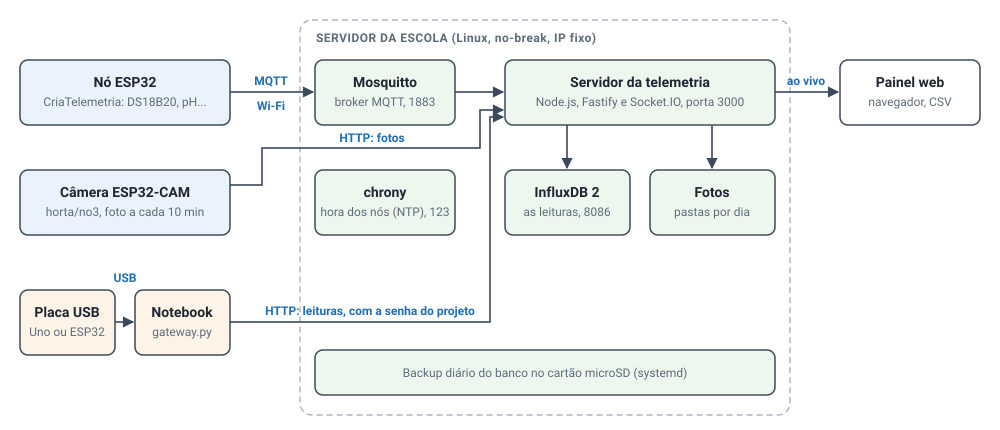
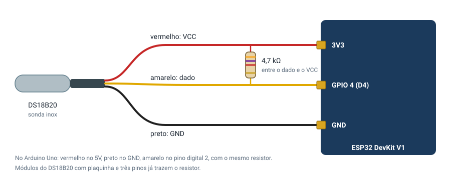
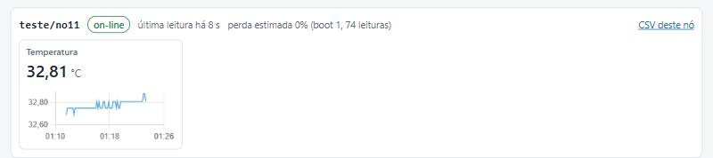
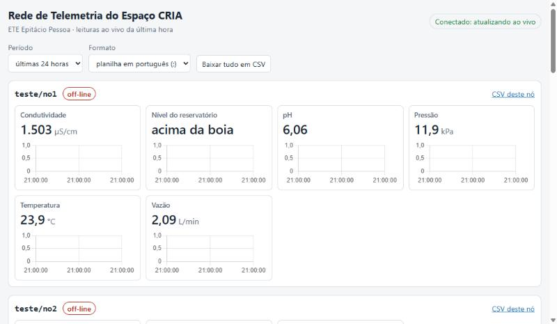

Este guia reúne, num documento só, tudo o que é preciso para instalar a plataforma e colocar um sensor publicando no painel. Ele vai do zero até um nó ESP32 ligado pelo Wi-Fi, passando pelo caminho mais simples, o do notebook ligado à placa pela porta USB. Todos os exemplos usam o sensor de temperatura **DS18B20**, o mais barato e o mais fácil de ligar de todos os sensores do projeto.

Os terminais e as telas mostrados aqui foram capturados em 19/10/2026, com uma ESP32 DevKit ligada na porta COM5 de um notebook com Windows 11 e com o servidor de teste rodando num Ubuntu 26.04 (dentro do WSL do mesmo notebook).

O guia tem três partes:

- **Parte I, instalar:** o servidor da escola (Linux) e o computador de quem programa as placas (Windows ou Linux).
- **Parte II, os primeiros testes com o notebook pela USB:** a placa escrevendo as leituras na serial, depois o gateway enviando ao servidor e o painel mostrando.
- **Parte III, o nó pelo Wi-Fi:** a biblioteca-padrão, o nó publicando por MQTT, a calibração pela USB e o que fazer quando algo falha.

Os detalhes de cada peça estão nos READMEs do repositório, citados ao longo do texto.

## Como a plataforma funciona



Uma leitura faz este caminho:

1. **O nó mede.** Um ESP32 com um sensor lê o valor e, com a biblioteca-padrão **CriaTelemetria**, publica uma mensagem no broker MQTT pelo Wi-Fi. Cada mensagem leva o valor, a unidade, um número de sequência (`seq`), o número da vez que o nó ligou (`boot`) e a hora da medida (`t`).
2. **O broker repassa.** O **Mosquitto**, no servidor da escola, recebe a mensagem e a entrega a quem assinou o tópico. Cada projeto tem um usuário e uma senha, e só publica dentro do próprio projeto.
3. **O servidor guarda e mostra.** O servidor da telemetria, em **Node.js**, assina todos os tópicos, confere cada mensagem contra o catálogo, grava no **InfluxDB** e repassa ao painel na hora, pelo Socket.IO.
4. **O painel exibe.** Qualquer navegador da rede abre o painel, vê os nós, os últimos valores, os gráficos da última hora e baixa os dados em CSV.

As placas sem rede (Arduino Uno, ou uma ESP32 sem Wi-Fi configurado) usam um segundo caminho: escrevem as leituras pela **USB**, e um programa no notebook, o **gateway**, as envia ao servidor por HTTP com a senha do projeto. É por esse caminho que começam os testes deste guia.

O endereço de cada medida é um tópico com quatro partes, `cria/{projeto}/{no}/{grandeza}`, por exemplo `cria/teste/no11/temperatura`. As regras dos nomes, as unidades e os projetos registrados estão no [catálogo de tópicos](../mqtt/catalogo-topicos.md). O projeto `teste` é livre para as oficinas e para os testes deste guia.

## O que você precisa

**Material para os testes:**

| Item | Observação |
| --- | --- |
| Placa **ESP32 DevKit V1** (30 pinos) | Qualquer ESP32 com chip USB CP210x ou CH340 serve |
| Cabo USB **de dados** | Cabo só de carga não serve: a placa acende, mas não aparece no computador |
| Sensor **DS18B20** à prova d'água | Três fios: vermelho, preto e amarelo |
| Resistor de **4,7 kΩ** | Entre o fio amarelo e o vermelho. Os módulos com plaquinha já trazem |
| Protoboard e jumpers | |

**Computadores:**

- **O servidor da escola**, com Ubuntu 22.04 ou mais novo (ou Debian 12), ligado à rede da telemetria e, de preferência, a um no-break. Para testar em casa, um Ubuntu no WSL do Windows serve, como foi feito aqui (seção 2.4).
- **O computador de quem programa as placas**, com Windows 10 ou 11, ou Linux. Nele vão a Arduino IDE, o Python e uma cópia do repositório.

**Com o coordenador:** o endereço IP do servidor, a senha MQTT do projeto `teste` e, para o Wi-Fi, o nome e a senha da rede da telemetria.

# Parte I: instalar

## 1. Baixar o repositório

Todo o software fica no repositório [telemetria-cria](https://github.com/ErlyAquino/telemetria-cria). Ele precisa ser clonado no servidor e no computador de desenvolvimento. O passo a passo do Git, da conta no GitHub e do fluxo de trabalho está no [Tutorial 00](00-conta-github-e-git.md); em resumo:

```bash
git clone https://github.com/ErlyAquino/telemetria-cria.git
cd telemetria-cria
```

No Windows, instale antes o [Git para Windows](https://git-scm.com/download/win) e use o **Git Bash** ou o PowerShell.

## 2. O servidor (Linux)

### 2.1 O servidor base: broker, hora e banco

No servidor, na pasta do repositório, com o computador ligado à internet durante a instalação:

```bash
sudo bash servidor/base/instalar.sh
```

O script instala e configura três programas que ficam ligados o tempo todo:

| Programa | O que faz | Porta |
| --- | --- | --- |
| **Mosquitto** | Broker MQTT: recebe o que os nós publicam e repassa a quem assinou | 1883 |
| **chrony** | Servidor de hora (NTP): acerta o relógio dos nós sem internet | 123 |
| **InfluxDB 2** | Banco de séries temporais: guarda cada leitura com a hora | 8086 |

Durante a instalação ele pede as senhas: uma para cada usuário MQTT (`servidor`, `ar`, `horta` e `teste`) e uma para o administrador do InfluxDB. Anote-as num lugar seguro, fora do repositório. As senhas aceitam letras sem acento, algarismos e os sinais `. _ @ % + = : , ! ? -`.

No fim, o script faz um autoteste e escreve `OK` ou `FALHA` em três conferências: o servidor recebe o que o projeto `teste` publica, o usuário `teste` não consegue publicar no projeto `horta`, e o broker recusa quem chega sem senha. Ele também grava no `.env` da raiz do repositório as senhas do `servidor` e do `teste` e o token do banco. Esse arquivo só o dono pode ler e nunca vai para o GitHub.

Depois de instalar:

- **Reserve um IP fixo para o servidor** no roteador da telemetria. É esse IP que vai nos nós, no gateway e nos navegadores.
- **Guarde uma cópia de `/root/.influxdbv2/configs`** fora do servidor: é o único lugar com o token de administrador do banco.

Tudo isso, com os comandos de manutenção e o uso do nó simulado, está em [`servidor/base/README.md`](../servidor/base/README.md).

### 2.2 O servidor da telemetria e o painel

O servidor da telemetria é um programa em Node.js. Precisa do **Node.js 22** ou mais novo: no Ubuntu, instale pelo site [nodejs.org](https://nodejs.org/) (a versão LTS), porque a do `apt` costuma ser antiga. Depois, na pasta `servidor/`:

```bash
cd servidor
npm install
npm start
```

O terminal mostra algo assim:

```
InfluxDB: respondendo em http://localhost:8086
Painel: http://localhost:3000  (saúde em /saude)
MQTT: conectado a localhost:1883 como "servidor" (sessão nova)
```

Abra `http://IP_DO_SERVIDOR:3000` em qualquer computador ou celular da rede. Enquanto nenhum nó publicou, o painel diz "Nenhum nó publicou ainda". Para ver leituras sem placa nenhuma, rode em outro terminal o nó simulado: `npm run simulador`.

O `npm start` precisa ficar rodando. Num servidor de verdade ele deve subir sozinho quando o computador liga, como serviço do sistema; esse serviço está sendo preparado e será documentado em `servidor/base/README.md`. Até lá, deixe o terminal aberto ou use um `tmux`.

As rotas, os eventos e as variáveis do `.env` estão em [`servidor/README.md`](../servidor/README.md).

### 2.3 Backup do banco

O banco guarda todas as leituras do projeto. O backup diário num cartão microSD, e o teste de restauração, são instalados com:

```bash
sudo bash servidor/base/backup/instalar-backup.sh /mnt/backup-telemetria
```

O passo a passo, inclusive a formatação do cartão, está em [`servidor/base/backup/README.md`](../servidor/base/backup/README.md). Um backup só vale depois de restaurado numa cópia: faça o teste a cada quinzena.

### 2.4 Um servidor de teste no Windows, pelo WSL

Para testar em casa, sem o servidor da escola, o Ubuntu do **WSL** (Subsistema do Windows para Linux) serve como servidor. Foi assim que os testes deste guia foram feitos.

1. Instale o WSL com o Ubuntu: num PowerShell como administrador, `wsl --install -d Ubuntu`, e reinicie.
2. Dentro do Ubuntu, clone o repositório e siga as seções 2.1 e 2.2.
3. Descubra o IP do Ubuntu com `hostname -I` (por exemplo, `172.30.133.181`). É esse endereço que o gateway e o navegador do Windows usam. Ele pode mudar quando o WSL reinicia.

Três cuidados:

- O WSL desliga o Ubuntu alguns segundos depois de fechar o último terminal. Deixe um terminal do Ubuntu aberto durante os testes.
- Os nós ESP32 pelo Wi-Fi **não alcançam** o Ubuntu do WSL, porque ele fica atrás de uma rede interna do Windows (NAT). O WSL serve para o caminho da USB (Parte II) e para o painel; o nó pelo Wi-Fi (Parte III) precisa de um servidor Linux na mesma rede que a placa.
- Se o Windows tiver um Mosquitto próprio instalado, ele atende na porta 1883 do `localhost` e aceita conexão sem senha. Um teste que erre o endereço publica nele sem dar erro. Use sempre o IP do Ubuntu.

## 3. O computador de desenvolvimento

É o computador de quem grava as placas e roda o gateway. Precisa de quatro coisas: o repositório (seção 1), a Arduino IDE, o Python com a biblioteca `pyserial` e o acesso à porta serial.

### 3.1 Arduino IDE 2

1. Instale a **Arduino IDE 2** pelo site [arduino.cc/en/software](https://www.arduino.cc/en/software). No Windows, prefira o instalador `.exe`; no Linux, o AppImage ou o pacote da sua distribuição.
2. **Núcleo do ESP32.** Em *Arquivo → Preferências*, no campo *URLs adicionais do Gerenciador de Placas*, cole:

   ```
   https://espressif.github.io/arduino-esp32/package_esp32_index.json
   ```

   Em *Ferramentas → Placa → Gerenciador de Placas*, procure **esp32** e instale o da **Espressif Systems**, versão 3 ou mais nova. O download é grande (centenas de MB).
3. **Bibliotecas.** Em *Ferramentas → Gerenciar Bibliotecas*, instale:
   - **OneWire**, de Jim Studt e outros;
   - **DallasTemperature**, de Miles Burton;
   - **PubSubClient**, de Nick O'Leary (para o Wi-Fi, na Parte III).
4. **A biblioteca da rede.** Veja em *Arquivo → Preferências* o *Local do sketchbook*. Copie a pasta `firmware/biblioteca-cria` do repositório para a subpasta `libraries` desse local e reinicie a IDE. Ela aparece como **CriaTelemetria**, com os exemplos em *Arquivo → Exemplos → CriaTelemetria*. No Windows com OneDrive, o local pode não ser `Documentos\Arduino`: use o que a IDE mostrar.

Quem prefere a linha de comando pode usar o **arduino-cli** no lugar da IDE; os comandos de compilação aparecem nos READMEs de cada nó.

### 3.2 Python e pyserial

O gateway e a ferramenta de calibração são em Python e usam uma biblioteca só, a **pyserial**.

- **Windows:** instale o Python 3 pelo site [python.org](https://www.python.org/downloads/), marcando a opção **Add python.exe to PATH**. Depois, na pasta do repositório:

  ```
  py -m pip install -r gateway/requirements.txt
  ```

- **Ubuntu ou Debian:**

  ```bash
  sudo apt install python3-serial
  ```

### 3.3 A porta serial

Ligue a placa no USB. Ela precisa aparecer como uma porta serial:

- **Windows:** abra o *Gerenciador de Dispositivos* e procure em *Portas (COM e LPT)* a porta nova, por exemplo `COM5`. Se nada aparecer, instale o driver do chip USB da placa, escrito perto do conector: **CP210x** (Silicon Labs) ou **CH340** (WCH). Os computadores do laboratório podem não ter internet: baixe o instalador antes e leve-o num pendrive.
- **Linux:** a porta é `/dev/ttyUSB0` (CP210x e CH340) ou `/dev/ttyACM0` (Arduino Uno original). Dê ao seu usuário permissão para usá-la e entre de novo na sessão:

  ```bash
  sudo usermod -aG dialout $USER
  ```

  O comando `ls /dev/serial/by-id/` lista as placas ligadas pelo nome; esse caminho também serve como porta. No Ubuntu, o pacote `brltty` toma as portas dos clones com CH340; se a porta aparecer e sumir, remova-o com `sudo apt remove brltty`.

> **A porta é de um programa de cada vez.** O Monitor Serial da Arduino IDE, o gateway e a ferramenta de calibração não podem usar a mesma porta ao mesmo tempo. Feche o Monitor Serial antes de rodar os programas do notebook.

# Parte II: os primeiros testes com o notebook pela USB

## 4. Montar o DS18B20



| Fio do DS18B20 | Liga em |
| --- | --- |
| Vermelho (VCC) | 3V3 da ESP32 |
| Preto (GND) | GND da ESP32 |
| Amarelo (dado) | GPIO 4 (D4), com o resistor de 4,7 kΩ entre o amarelo e o vermelho |

No Arduino Uno: vermelho no 5V, preto no GND, amarelo no pino digital 2, com o mesmo resistor. Se o sensor vier num módulo com plaquinha e três pinos, o resistor já está nele.

Dois sinais de montagem errada, que o programa já reconhece e avisa: **−127 °C** é sensor desconectado ou sem o resistor; **85 °C** é o valor de partida do chip, antes da primeira conversão.

## 5. Teste 1: a placa escrevendo as leituras

O primeiro teste não precisa de servidor nem de rede. A placa recebe o programa `firmware/arduino-usb`, que lê o DS18B20 a cada 10 s e escreve uma linha JSON por leitura na USB.

1. Na Arduino IDE, abra `firmware/arduino-usb/arduino-usb.ino`.
2. Escolha um nó livre. Abra o painel e veja quais nós do projeto `teste` já existem; troque a linha `const char* NO = "no1";` por um número que não apareça ali. Neste guia, a placa foi gravada como `no11`.
3. Em *Ferramentas → Placa*, escolha **DOIT ESP32 DEVKIT V1** (ou *Arduino Uno*, se for o caso) e a porta da placa.
4. Clique em *Carregar*. Se a IDE ficar parada em `Connecting...`, segure o botão **BOOT** da placa até a gravação começar.
5. Abra *Ferramentas → Monitor Serial* a **115200** baud.

O Monitor Serial mostra a mensagem de partida e, a cada 10 s, uma leitura:

```
telemetria: no11
{"no":"no11","grandeza":"temperatura","valor":32.88,"unidade":"C","seq":1}
{"no":"no11","grandeza":"temperatura","valor":32.81,"unidade":"C","seq":2}
{"no":"no11","grandeza":"temperatura","valor":32.81,"unidade":"C","seq":3}
```

Cada linha traz o nó, a grandeza, o valor, a unidade e o `seq`, que cresce de 1 em 1 e recomeça em 1 quando a placa reinicia. Se aparecer `DS18B20 sem leitura valida`, confira a fiação e o resistor.

Esse programa serve para qualquer sensor: para trocar o DS18B20 por outro, mude só a leitura dentro do `loop()` e chame `publicar()` com a grandeza e a unidade do catálogo.

## 6. Teste 2: o gateway enviando ao servidor

Agora a leitura vai da placa ao painel. O **gateway** (`gateway/gateway.py`) lê a porta serial, acrescenta a hora e o `boot` a cada leitura e envia tudo ao servidor por HTTP, com o usuário e a senha do projeto.

### 6.1 Configurar

Copie o `.env.example` da raiz do repositório para `.env`, na mesma pasta, e preencha quatro linhas:

```
PORTA_SERIAL=COM5
SERVIDOR_URL=http://172.30.133.181:3000
GATEWAY_PROJETO=teste
GATEWAY_SENHA=a senha MQTT do projeto teste
```

No Linux, a porta é `/dev/ttyUSB0`. O endereço é o IP do servidor. A senha do projeto `teste` fica no `.env` do servidor, em `SIMULADOR_SENHA`; peça a quem cuida dele.

### 6.2 Rodar

Feche o Monitor Serial e, na raiz do repositório:

```bash
py gateway/gateway.py          # Windows
python3 gateway/gateway.py     # Linux
```

O gateway abre a porta, mostra o que chega da placa e confirma cada envio:

```
01:11:42  gateway do projeto "teste" enviando para http://172.30.133.181:3000. Ctrl+C encerra.
01:11:42  porta COM5 aberta a 115200 baud; esperando leituras.
01:11:42  placa: telemetria: no11
01:11:43  1 leitura enviada (no11 boot 1); seq até 1.
01:11:53  1 leitura enviada (no11 boot 1); seq até 2.
01:12:03  1 leitura enviada (no11 boot 1); seq até 3.
01:12:13  1 leitura enviada (no11 boot 1); seq até 4.
```

As linhas `placa: ...` são as mensagens da própria placa, inclusive as de partida da ESP32. O `boot` é criado pelo gateway: ele sobe de 1 cada vez que o `seq` da placa volta, e fica guardado em `gateway/.estado/`.

### 6.3 Ver no painel

Abra `http://IP_DO_SERVIDOR:3000`. O cartão `teste/no11` aparece **on-line**, com o último valor, o gráfico da última hora e a perda estimada:



O painel inteiro, com os outros nós e a exportação em CSV, é assim:



Os nós "sem notícia" são de testes anteriores. Um nó alimentado pelo gateway fica **off-line** no painel quando passa 30 s sem leituras, porque as placas USB não têm o aviso de queda (LWT) do MQTT.

### 6.4 O que acontece quando algo falha

Com o gateway rodando, experimente desligar o servidor por meio minuto. O terminal mostra as leituras esperando e as tentativas, com espera crescente:

```
servidor fora do alcance (...); 1 leitura esperando, nova tentativa em 1 s.
servidor fora do alcance (...); 2 leituras esperando, nova tentativa em 2 s.
...
4 leituras enviadas (no11 boot 1); seq até 8.
```

Quando o servidor volta, as leituras guardadas saem de uma vez, marcadas com `"fila": 1`, e nenhum `seq` se perde. Desconectar a placa também não derruba o gateway: ele tenta reabrir a porta a cada 5 s. A tabela completa das falhas e das mensagens está em [`gateway/README.md`](../gateway/README.md).

# Parte III: o nó pelo Wi-Fi

## 7. A biblioteca-padrão CriaTelemetria

No caminho do Wi-Fi, a placa fala direto com o broker, sem notebook no meio. A biblioteca **CriaTelemetria** cuida de tudo o que não é ler o sensor:

- conecta no Wi-Fi e reconecta quando a rede cai;
- conecta no broker com o usuário do projeto e avisa quando está on-line e off-line;
- acerta o relógio pelo servidor de hora da rede e só começa a medir depois disso;
- numera as leituras (`seq`) e conta as vezes que o nó ligou (`boot`);
- guarda na memória flash as leituras feitas sem conexão e as reenvia quando a conexão volta, mesmo que o nó tenha reiniciado;
- guarda a calibração de cada sensor na memória do nó.

Um nó novo só precisa ler o próprio sensor e chamar `publicar()`. A referência completa está em [`firmware/biblioteca-cria/README.md`](../firmware/biblioteca-cria/README.md).

## 8. Teste 3: o nó com DS18B20 publicando pelo Wi-Fi

O exemplo `NoDS18B20` da biblioteca é o mesmo sensor da Parte II, agora publicando pelo Wi-Fi. A montagem não muda.

### 8.1 Abrir o exemplo e salvar uma cópia

Na Arduino IDE, abra *Arquivo → Exemplos → CriaTelemetria → NoDS18B20* e use *Arquivo → Salvar como* para ter uma cópia editável, por exemplo `meu-no-ds18b20`. Exemplos não podem ser editados no lugar.

O programa inteiro cabe numa tela:

```cpp
#include <CriaTelemetria.h>
#include <DallasTemperature.h>
#include <OneWire.h>
#include "credenciais.h"

const int PINO_DS18B20 = 4;

CriaNo no("teste", "no1");          // troque "no1" por um nó livre
CriaCalibracao calibracao(no);
OneWire umFio(PINO_DS18B20);
DallasTemperature ds18b20(&umFio);

double temperaturaBruta() {
  ds18b20.requestTemperatures();
  float t = ds18b20.getTempCByIndex(0);
  if (t == DEVICE_DISCONNECTED_C || t == 85.0) return NAN;  // sensor com falha
  return t;
}

void setup() {
  Serial.begin(115200);
  ds18b20.begin();
  calibracao.sensor("temperatura", "C", temperaturaBruta, 1.0, 0.0, false);
  calibracao.iniciar();
  no.mostrarPublicacoes(true);
  no.iniciar(WIFI_SSID, WIFI_SENHA, MQTT_HOST, MQTT_PORTA, MQTT_USUARIO, MQTT_SENHA);
}

void loop() {
  calibracao.atender();
  no.manter();
  if (no.aCada(10000)) {
    double temperatura = calibracao.ler("temperatura");
    if (!isnan(temperatura)) no.publicar("temperatura", temperatura, "C");
  }
}
```

### 8.2 As credenciais

Na seta ao lado das abas, à direita, escolha *Nova aba* e chame-a de `credenciais.h`. Cole nela o conteúdo de `firmware/credenciais.exemplo.h` e preencha:

```cpp
#define WIFI_SSID    "rede-telemetria"
#define WIFI_SENHA   "a senha do Wi-Fi"
#define MQTT_HOST    "192.168.0.10"      // o IP do servidor
#define MQTT_PORTA   1883
#define MQTT_USUARIO "teste"             // o mesmo nome do projeto no programa
#define MQTT_SENHA   "a senha MQTT do projeto teste"
```

O `MQTT_USUARIO` precisa ser igual ao projeto do `CriaNo`: se não for, o nó avisa e não publica. O `credenciais.h` está no `.gitignore` e nunca vai para o GitHub. Senha enviada ao GitHub por engano deve ser trocada no servidor na mesma hora.

### 8.3 Nó livre, gravação e conferência

1. Troque `"no1"` por um nó que não apareça no painel. Dois nós com o mesmo nome se derrubam um ao outro no broker, e o Monitor Serial avisa que "a conexão cai logo depois de abrir".
2. Clique em *Carregar*.
3. Abra o Monitor Serial a 115200 baud e reinicie a placa pelo botão **EN**. A saída esperada, com as mensagens da biblioteca, é esta:

```
[cal] temperatura: reta da folha de dados (medida = 1 * C + 0)
[cria] nó cria/teste/no7, biblioteca CriaTelemetria 0.2.0
[cria] boot 1
[cria] aguardando o Wi-Fi "rede-telemetria"...
[cria] Wi-Fi conectado, IP 192.168.0.23
[cria] conectado ao broker; status online em cria/teste/no7/status
[cria] relógio acertado: 2026-10-19 04:12:07 UTC
[cria] cria/teste/no7/temperatura {"valor":27.4,"unidade":"C","seq":1,"boot":1,"t":1792383127113}
```

A hora pode levar até uns 30 segundos para chegar; antes dela, nada é medido. No painel, o cartão do nó aparece on-line com a temperatura, exatamente como o da Parte II. A diferença é que agora não há gateway: a placa, o broker e o servidor conversam sozinhos.

> **Os testes deste guia pararam aqui.** O servidor de teste usado nas capturas roda no WSL, que os nós não alcançam pelo Wi-Fi (seção 2.4). O trecho acima mostra as mensagens que a biblioteca escreve, com os valores de exemplo; o teste com a rede da escola ainda está por fazer e deve ser registrado no caderno quando acontecer.

### 8.4 Quedas de rede e do servidor

A biblioteca foi feita para a rede cair. Com o nó publicando, experimente desligar o servidor ou o roteador por um minuto e observe o Monitor Serial:

- `conexão com o broker caiu; as leituras vão para a fila`: o nó guarda cada leitura na memória flash, com o `seq` que ela recebeu na hora da medida;
- `fila esvaziada: todas as leituras guardadas foram reenviadas`: quando a conexão volta, as leituras saem marcadas com `"fila":1`, e o painel e o banco as recebem na ordem certa.

A fila guarda cerca de 6000 leituras, mais de 2 h de um nó com seis grandezas a cada 10 s. Um reinício do nó no meio da queda não apaga a fila.

## 9. Calibrar o DS18B20 pela USB

O DS18B20 sai de fábrica com erro de até 0,5 °C. A ferramenta de calibração corrige o zero contra um termômetro de referência e grava a correção na memória do nó, onde ela sobrevive a desligar a placa e a gravar um programa novo. É a mesma ferramenta usada no pH e na condutividade da horta.

Com o nó ligado ao notebook pela USB e o Monitor Serial fechado, na raiz do repositório:

```bash
py calibracao/calibrar.py --porta COM5 temperatura
```

A ferramenta conduz o roteiro. Esta captura é de um teste real, com a ESP32 do guia, e o "termômetro de referência" marcava 32,40 °C. A espera para a leitura se firmar é de 120 s por padrão; no teste ela foi encurtada com `--estabilizar 20`:

```
Calibração de temperatura do nó teste/no1 (um-ponto-deslocamento).
Reta atual: temperatura = 1,000000 x C + 0,000000 (da folha de dados)
Digite "sair" em qualquer pergunta para desistir sem gravar nada.

Ponto 1 de 1: mergulhe o DS18B20 e o termômetro de referência juntos, num copo com água.
   Tecle Enter quando o sensor estiver na solução.
   Esperando 20 s para a leitura se firmar (Ctrl+C interrompe a ferramenta).
   faltam  10 s   bruto agora: 32,6875 C
   faltam   0 s   bruto agora: 32,6875 C
   Coletando 10 amostras, uma por segundo...
   média 32,73750 C, desvio 0,02635 (10 amostras)
   Leia agora: valor do termômetro de referência, em C: 32,40

Reta nova: temperatura = 1,000000 x C - 0,337500

Gravar a reta nova na memória do nó? [S/n]
   Gravado no nó: temperatura = 1,000000 x C - 0,337500

Registro: calibracao\2026-10-19-temperatura-no1.csv e calibracao\coeficientes.csv. Anote no caderno e faça o commit:
   git add calibracao/ && git commit -m "Registra a calibração de temperatura do no1 de 19/10"
```

O nó passa a publicar a temperatura corrigida. O `--listar` mostra as retas gravadas:

```
Nó teste/no1:
  temperatura = 1,000000 x C - 0,337500   (calibrado em 19/10/2026 01:09)
```

Os pontos e a reta ficam registrados em `calibracao/`, em CSV, no formato da página de calibração do caderno do projeto, e o `gerar_relatorio.py` monta o relatório de calibração. O roteiro do pH (dois tampões e uma solução de verificação) e o da condutividade estão em [`calibracao/README.md`](../calibracao/README.md).

## 10. Ver e usar os dados

| Para | Onde |
| --- | --- |
| Acompanhar ao vivo | `http://IP_DO_SERVIDOR:3000` |
| Baixar em CSV | Botão *Baixar tudo em CSV* ou *CSV deste nó* no painel. O padrão abre direto no Excel em português; o formato internacional usa vírgula e ponto decimal |
| Ver o estado do servidor | `http://IP_DO_SERVIDOR:3000/saude`: broker, banco, contagem de leituras e a latência medida |
| Listar os nós | `http://IP_DO_SERVIDOR:3000/api/nos` |
| Ver tudo o que chega ao broker | No servidor: `mosquitto_sub -h localhost -u servidor -P 'SENHA' -t 'cria/#' -v` |

Para o teste de aceitação de 24 h, com os seis critérios do plano de trabalho (perda, latência, pH, condutividade, disponibilidade e reuso), o roteiro e as ferramentas estão em [`validacao/README.md`](../validacao/README.md).

## 11. Problemas comuns

| Sintoma | O que fazer |
| --- | --- |
| A placa não aparece como porta serial | Troque o cabo USB por um de dados; instale o driver CP210x ou CH340 |
| `Connecting...` sem fim na gravação | Segure o botão **BOOT** da placa até começar |
| `could not open port` ou `Permission denied` | Feche o Monitor Serial; no Linux, confira o grupo `dialout` e o `brltty` |
| `DS18B20 sem leitura valida` ou −127 °C | Confira os três fios e o resistor de 4,7 kΩ entre o amarelo e o vermelho |
| 85 °C fixo | O sensor ainda não converteu: espere a próxima leitura; se persistir, falta alimentação |
| Gateway: `servidor fora do alcance` | Confira o `SERVIDOR_URL`, se o servidor está no ar e, no WSL, se o Ubuntu não desligou |
| Gateway: `o servidor recusou o projeto` | Confira `GATEWAY_PROJETO` e `GATEWAY_SENHA` no `.env` |
| Gateway: `outro gateway deste computador já está usando o nó` | Cada placa precisa de um nó só seu; o segundo gateway recebe a porta dele com `--porta` |
| Nó Wi-Fi: `rede não encontrada` | Confira o `WIFI_SSID`, letra por letra, e se o roteador está ligado |
| Nó Wi-Fi: `o ponto de acesso recusou a conexão` | Confira a `WIFI_SENHA` |
| Nó Wi-Fi: `usuário ou senha recusados` | Confira `MQTT_USUARIO` e `MQTT_SENHA` |
| Nó Wi-Fi: `MQTT_USUARIO é ... mas o projeto é ...` | Os dois precisam ser iguais, `"teste"` nos dois |
| Nó Wi-Fi: `esperando a hora do servidor` | O chrony não respondeu: confira a porta 123/udp do servidor |
| Nó Wi-Fi: `a conexão cai logo depois de abrir` | Outro nó usa o mesmo nome: troque o número |
| Painel: nó "sem notícia" | O nó nunca publicou desde que o servidor ligou; os valores vêm do banco |
| Painel: nó USB off-line | Passaram 30 s sem leitura: veja o terminal do gateway |

## 12. Próximos passos

- **O nó da horta** (`firmware/horta-no1`): pH, condutividade, vazão, pressão, nível e a proteção da bomba, com a montagem pino a pino em [`firmware/horta-no1/README.md`](../firmware/horta-no1/README.md). O `no2` mede o ambiente e o `no3` é a câmera.
- **A calibração do pH e da condutividade**, com os tampões e a solução-padrão: [`calibracao/README.md`](../calibracao/README.md).
- **O teste de aceitação de 24 h**: [`validacao/README.md`](../validacao/README.md).
- **As decisões técnicas**, uma por arquivo, com data, motivo e o que se perde: pasta `decisoes/`.

## Anexo: referência rápida

Comandos na raiz do repositório. No Linux, troque `py` por `python3`.

| Tarefa | Comando |
| --- | --- |
| Instalar o servidor base | `sudo bash servidor/base/instalar.sh` |
| Subir o servidor e o painel | `cd servidor && npm install && npm start` |
| Nó simulado | `cd servidor && npm run simulador` |
| Gateway da placa USB | `py gateway/gateway.py --porta COM5` |
| Listar as retas de um nó | `py calibracao/calibrar.py --porta COM5 --listar` |
| Calibrar a temperatura | `py calibracao/calibrar.py --porta COM5 temperatura` |
| Relatório de calibração | `py calibracao/gerar_relatorio.py` |
| Backup do banco | `sudo bash servidor/base/backup/instalar-backup.sh /mnt/backup-telemetria` |
| Testar a restauração | `sudo telemetria-testar-restauracao` |
| Testes automáticos | `cd servidor && npm test`; `py -m unittest discover -s gateway`; `py -m unittest discover -s calibracao` |
| Gerar este guia em HTML e PDF | `py tutoriais/gerar-documentos.py` |

A estrutura completa do repositório está no [README](../README.md) da raiz. O código é MIT; os textos, dados e modelos 3D são CC BY 4.0.
